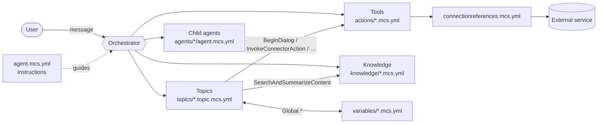
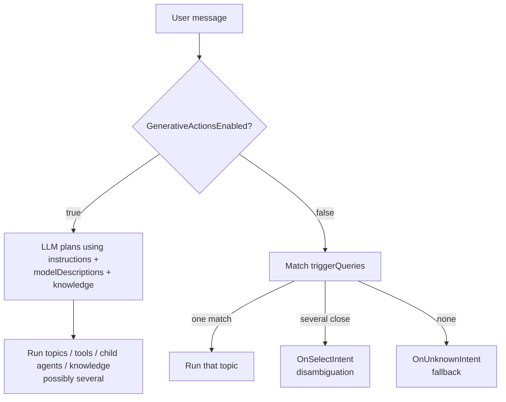

# 01 — Concepts

This page builds the mental model you need before writing any YAML: what an agent is made of, how those parts
reference each other, and how a user's message gets routed to the right part.

## The pieces of an agent

A Copilot Studio [agent](glossary.md#agent) (an AI chat assistant) is a bundle of **components**. Each component is
one YAML file, and each has a `kind:` saying what it is.

| Component | What it is | File(s) | `kind:` |
|---|---|---|---|
| **Agent definition** | Name, [instructions](glossary.md#instructions) (system prompt), [conversation starters](glossary.md#conversation-starter), model choice | `agent.mcs.yml` | [GptComponentMetadata](reference/schema/components.md#gptcomponentmetadata) |
| **Settings** | Orchestration mode, auth mode, recognizer, language | `settings.mcs.yml` | *(no kind; see [03](03-agent.md#settingsmcsyml))* |
| **Topic** | A scripted conversation flow: a [trigger](glossary.md#trigger) plus a list of steps ([nodes](glossary.md#node)) | `topics/*.topic.mcs.yml` | [AdaptiveDialog](reference/schema/dialogs.md#adaptivedialog) |
| **Tool** | A callable capability: a [connector](glossary.md#connector) operation (a pre-built wrapper around an external API), an [MCP](glossary.md#mcp) server, a [flow](glossary.md#cloud-flow), another agent | `actions/*.mcs.yml` | [TaskDialog](reference/schema/dialogs.md#taskdialog) |
| **Knowledge source** | Content the agent can search to [ground](glossary.md#grounding) answers: websites, SharePoint, files, databases | `knowledge/*.knowledge.mcs.yml` | [KnowledgeSourceConfiguration](reference/schema/components.md#knowledgesourceconfiguration) |
| **Global variable** | A conversation-wide variable, `Global.<Name>` | `variables/*.mcs.yml` | [GlobalVariableComponent](reference/schema/components.md#globalvariablecomponent) |
| **Child agent** | A specialised sub-agent the main agent delegates to | `agents/<name>/agent.mcs.yml` | [AgentDialog](reference/schema/dialogs.md#agentdialog) |
| **Connection references** | Named pointers to authenticated [connections](glossary.md#connection) that tools use | `connectionreferences.mcs.yml` | — |

> **Naming note.** In older Copilot Studio docs and in the schema, a *tool* is called an **action**, and an *agent*
> is called a **bot** or **copilot**. That's why tools live in a folder called `actions/` and so many schema names
> start with `Bot…`. A topic's steps are *also* listed under a property called `actions:`. See the
> [glossary entry for Action](glossary.md#action).



## Topics are flow charts

A [topic](glossary.md#topic) has:

1. **A trigger** (`beginDialog:`), which says *when* the topic runs: when the user expresses a certain intent, when
   the conversation starts, when an error happens, when nothing else matched, and so on. There are 28 trigger kinds;
   see [04 Topics & triggers](04-topics-and-triggers.md).
2. **A list of nodes** (`beginDialog.actions:`), which says *what* happens: send a message, ask a question, set a
   variable, branch, loop, call a tool, search knowledge, jump to another topic. There are 52 node kinds; see
   [05 Nodes](05-nodes.md).
3. Optionally, **inputs and outputs** (`inputs:`, `inputType:`, `outputType:`). These let the orchestrator call the
   topic like a function, filling inputs from the conversation and reading outputs afterwards.

```yaml
kind: AdaptiveDialog
modelDescription: Use this topic when the user wants to know the opening hours of a store.
beginDialog:
  kind: OnRecognizedIntent
  id: main
  intent:
    displayName: Opening hours
    triggerQueries:
      - when are you open
      - opening hours
      - what time do you close
  actions:
    - kind: SendActivity
      id: sendMessage_h0urs1
      activity: We're open 9am–5pm, Monday to Friday.
```

## How a message is routed

What happens to a user's message depends on the **orchestration mode**, set by `GenerativeActionsEnabled` in
`settings.mcs.yml`.

### Generative orchestration (`GenerativeActionsEnabled: true`)

An LLM [orchestrator](glossary.md#orchestrator) reads:

- the agent's **instructions**,
- the **`modelDescription`** of every topic, tool and child agent (this is the routing signal; see
  [model description](glossary.md#model-description)),
- **knowledge source** descriptions,
- the conversation so far, including [global variables](glossary.md#global-variable) marked
  `aIVisibility: UseInAIContext`.

It then **plans** a response. It may run one topic, call two tools in sequence, search knowledge, delegate to a child
agent, or simply answer. It fills topic and tool **inputs** from what the user has said, asking follow-up questions
only for missing values. This is [generative orchestration](glossary.md#generative-orchestration), and it is the
default for new agents.

Consequences for YAML authors:

- **Write a good `modelDescription`** on every intent-triggered topic and every tool. Say what it does, when to use
  it, and when *not* to.
- **Prefer topic `inputs:` (`AutomaticTaskInput`) over `Question` nodes** for information the topic always needs. The
  orchestrator fills them from context and only asks the user if it must. Use `Question` nodes for questions that are
  conditional (for example, "ask for a phone number only if the group is larger than 6").
- **You often don't need a "search knowledge" topic.** Knowledge sources are searched automatically. Use explicit
  `SearchAndSummarizeContent` nodes only when you need control over the query or the result.

### Classic orchestration (`GenerativeActionsEnabled: false`)

Each message is compared with every topic's **trigger phrases** (`intent.triggerQueries`). The best-matching topic
runs. If several match closely, the *Multiple Topics Matched* topic (`OnSelectIntent`) asks the user to choose. If
none match, the *Fallback* topic (`OnUnknownIntent`) runs, which commonly calls generative answers over knowledge.
This is [classic orchestration](glossary.md#classic-orchestration). It's more predictable, but needs 5–10 good
trigger phrases per topic.



### Topics that ignore routing

Many topics aren't triggered by what the user asks at all. *System* triggers fire on events: `OnConversationStart`
(greeting), `OnError`, `OnUnknownIntent`, `OnSignIn`, `OnEscalate`, `OnActivity` (any incoming activity matching a
condition), `OnGeneratedResponse` (just before an AI answer is sent), `OnKnowledgeRequested` (custom search), and
others. A topic with `OnSystemRedirect` can only be reached by another topic jumping to it. See
[04 Topics & triggers](04-topics-and-triggers.md).

## Expressions, templates and variables

Values in YAML are either literal text, a [Power Fx](glossary.md#power-fx) **expression** (starts with `=`), or a
**template** with `{…}` interpolation:

```yaml
# three nodes from a topic's actions: list (each validated on its own)
- kind: SetVariable
  id: setVariable_c0unt1
  variable: init:Topic.ItemCount          # init: creates the topic variable on first assignment
  value: =CountRows(Topic.Items)           # Power Fx expression

- kind: SendActivity
  id: sendMessage_c0unt2
  activity: "You have {Topic.ItemCount} items."   # template

- kind: SendActivity
  id: sendMessage_c0unt3
  activity: Thanks!                         # literal
```

Variables come in three scopes: `Topic.*` (this topic only), `Global.*` (whole conversation, declared in
`variables/`) and `System.*` (read-only runtime values such as `System.Activity.Text` and `System.Conversation.Id`).
See [06 Variables, entities & Power Fx](06-variables-entities-powerfx.md).

## Where things live: draft, published, local

| State | Who can see it |
|---|---|
| **Local** `.mcs.yml` files | You (and your tools) only |
| **Pushed** (draft) | The Copilot Studio web UI: authoring canvas and its built-in *Test* pane |
| **Published** | Real users in every [channel](glossary.md#channel) (Teams, web chat, …) and API test tools ([Direct Line](glossary.md#direct-line)) |

Pushing **doesn't** publish. See [02 Project layout & lifecycle](02-project-layout.md#lifecycle-clone--edit--validate--push--publish).

## What YAML can and can't do

The YAML route covers most authoring. However, some things **need the Copilot Studio web UI**, because they create
other Power Platform resources (connections, flows, AI models) as well as the agent's own rows:

- **Creating a brand-new agent.** Clone an existing (even empty) agent instead; you can't scaffold
  `agent.mcs.yml` + `settings.mcs.yml` from nothing.
- **Adding a connector or MCP tool for the first time.** The UI creates the [connection reference](glossary.md#connection-reference).
  After pulling, you can edit the tool's YAML freely.
- **Autonomous (event) triggers** and **AI Builder prompt** nodes. You can reference existing ones, but not
  create them in YAML.

Conversely, a few features work at runtime but are **YAML-only**: the UI doesn't display them and may silently
drop them if someone edits that component in the UI. Examples are custom Power Fx in a knowledge source's
`triggerCondition`, and `OnKnowledgeRequested` custom search topics. See [14 Gotchas](14-gotchas.md).

## Sources

- `vendor/skills-for-copilot-studio/skills/int-reference/SKILL.md`: file types, trigger types, routing mechanisms
- `vendor/skills-for-copilot-studio/skills/int-project-context/SKILL.md`: project structure, conventions
- `vendor/skills-for-copilot-studio/skills/edit-triggers/SKILL.md`: `modelDescription` vs trigger phrases
- `vendor/skills-for-copilot-studio/agents/copilot-studio-author.md`: authoring rules and UI-only limitations
- `vendor/skills-for-copilot-studio/agents/copilot-studio-advisor.md`: lifecycle states
