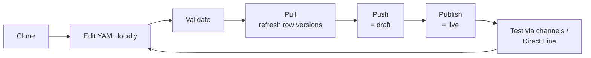

# 02 — Project layout & lifecycle

How an agent maps onto files, how files refer to each other, and how changes move between your disk and Copilot
Studio.

## Folder structure

When you **clone** an agent with the Copilot Studio [VS Code extension](glossary.md#vs-code-extension), or with
the skills repo's `manage-agent` script, you get a folder like this:

```text
<agent-dir>/
├── .mcs/
│   └── conn.json                   # where this agent came from (tenant, environment, endpoints) — don't edit
├── agent.mcs.yml                   # the agent: instructions, conversation starters, model  (GptComponentMetadata)
├── settings.mcs.yml                # schema name, auth mode, orchestration mode, recognizer, language
├── connectionreferences.mcs.yml    # named pointers to authenticated connections used by tools
├── topics/
│   ├── Greeting.topic.mcs.yml      # one topic per file                                   (AdaptiveDialog)
│   └── …
├── actions/
│   └── SendEmail.mcs.yml           # one tool per file                                    (TaskDialog)
├── knowledge/
│   └── ProductDocs.knowledge.mcs.yml  # one knowledge source per file          (KnowledgeSourceConfiguration)
├── variables/
│   └── UserCountry.mcs.yml         # one global variable per file                         (GlobalVariableComponent)
└── agents/
    └── HRSpecialist/
        └── agent.mcs.yml           # one child agent per sub-folder                        (AgentDialog)
```

Every content file ends in **`.mcs.yml`** (*mcs* = Microsoft Copilot Studio). Folders that the agent doesn't use may
be missing. To find an agent's root folder, look for the directory that contains `agent.mcs.yml`, and don't
hard-code the agent's name, because each clone uses whatever name the agent has in its environment.

| File | Role | `kind:` | Guide |
|---|---|---|---|
| `agent.mcs.yml` | Agent definition | [GptComponentMetadata](reference/schema/components.md#gptcomponentmetadata) | [03](03-agent.md) |
| `settings.mcs.yml` | Agent settings | *(none)* | [03](03-agent.md#settingsmcsyml) |
| `connectionreferences.mcs.yml` | [Connection references](glossary.md#connection-reference) | [ConnectionReferencesSourceFile](reference/schema/components.md#connectionreferencessourcefile) shape | [08](08-tools-and-connectors.md) |
| `topics/*.topic.mcs.yml` | [Topics](glossary.md#topic) | [AdaptiveDialog](reference/schema/dialogs.md#adaptivedialog) | [04](04-topics-and-triggers.md) |
| `actions/*.mcs.yml` | [Tools](glossary.md#tool) | [TaskDialog](reference/schema/dialogs.md#taskdialog) | [08](08-tools-and-connectors.md), [09](09-mcp-and-multi-agent.md) |
| `knowledge/*.knowledge.mcs.yml` | [Knowledge sources](glossary.md#knowledge-source) | [KnowledgeSourceConfiguration](reference/schema/components.md#knowledgesourceconfiguration) | [07](07-knowledge.md) |
| `variables/*.mcs.yml` | [Global variables](glossary.md#global-variable) | [GlobalVariableComponent](reference/schema/components.md#globalvariablecomponent) | [06](06-variables-entities-powerfx.md) |
| `agents/<name>/agent.mcs.yml` | [Child agents](glossary.md#child-agent) | [AgentDialog](reference/schema/dialogs.md#agentdialog) | [09](09-mcp-and-multi-agent.md) |

### File headers and `mcs.metadata`

Many files start with comment lines and/or an `mcs.metadata:` block. These hold the component's **display name**
and **description** as shown in the Copilot Studio UI. They aren't part of the `kind:` object itself:

```yaml
mcs.metadata:
  componentName: Microsoft Learn Docs MCP Server
  description: Searches Microsoft Learn documentation
kind: TaskDialog
modelDisplayName: Microsoft Learn Docs MCP Server
modelDescription: MCP Server to search Microsoft Learn content
action:
  kind: InvokeExternalAgentTaskAction
  connectionReference: cr26e_evalTest.shared_microsoftlearndocsmcpserver.abc123
  connectionProperties:
    mode: Invoker
  operationDetails:
    kind: ModelContextProtocolMetadata
    operationId: microsoft_docs_search
```

The skills' templates use `# Name: <display name>` as the first comment line for the same purpose (and, for child
agents and global variables, a second comment line for the description). Keep these lines when you edit a file.

### On-disk shape vs. schema shape

The JSON schema describes the **Dataverse** shape of each component. For two file types, the on-disk YAML
**flattens** that shape:

- `agent.mcs.yml` carries the component's `displayName:` at the root, next to the `GptComponentMetadata`
  properties.
- `variables/*.mcs.yml` puts the variable's own fields (`name`, `scope`, `aIVisibility`, `defaultValue`, …) at the
  root. In the schema they sit under `variable:` (see [Variable](reference/schema/actions.md#variable)).

The authoring tools handle this flattening. Follow the on-disk shapes shown in these guides and the vendor templates.

## settings.mcs.yml at a glance

```yaml
# fragment — settings.mcs.yml has no kind:, so it isn't schema-validated
displayName: Eval Test Agent
schemaName: eval_testAgent          # the agent's unique schema name (prefix for all its components)
accessControlPolicy: ChatbotReaders
authenticationMode: None            # None | Integrated | GenericOAuth2 | CustomAzureActiveDirectory
configuration:
  settings:
    GenerativeActionsEnabled: false # true = generative orchestration; false = classic
  recognizer:
    kind: GenerativeAIRecognizer
language: 1033                      # Windows locale ID (1033 = English, US)
```

See [03 The agent](03-agent.md#settingsmcsyml) for what each setting does.

## Schema names and IDs

### Component schema names

Every [component](glossary.md#component) has a globally unique **schema name** inside its [environment](glossary.md#environment). It is
built from the agent's `schemaName` (from `settings.mcs.yml`), the component type, and the component name:

| Component | Schema-name pattern | Example |
|---|---|---|
| Topic | `<agentSchema>.topic.<TopicName>` | `cr26e_myAgent.topic.Escalate` |
| Knowledge source | `<agentSchema>.knowledge.<name>` | `cr26e_myAgent.knowledge.glossary` |
| Global variable | `<agentSchema>.globalvariable.<Name>` | `cr26e_myAgent.globalvariable.UserCountry` |

(`cr26e_` is a typical Power Platform *publisher prefix*: every customisation is namespaced by the publisher of the
[solution](glossary.md#solution) it belongs to.)

You'll type schema names whenever one component refers to another. For example:

```yaml
# fragment — topic redirect and knowledge filter
- kind: BeginDialog
  id: beginDialog_esc4la
  dialog: cr26e_myAgent.topic.Escalate              # call another topic by schema name

- kind: SearchAndSummarizeContent
  id: searchContent_gl0ss1
  userInput: =System.Activity.Text
  knowledgeSources:
    kind: SearchSpecificKnowledgeSources
    knowledgeSources:
      - cr26e_myAgent.knowledge.glossary            # restrict search to one knowledge source
```

Connection references have their own logical names, such as `cr26e_evalTest.shared_microsoftlearndocsmcpserver.abc123`.
Copy them from `connectionreferences.mcs.yml` or from an existing tool; never invent them.

### Node IDs

Every node in a topic, and every condition branch inside a `ConditionGroup`, needs an **`id:`** that is unique
within the topic. The convention is `<nodeType>_<6–8 random letters/digits>`:

```text
sendMessage_g5Ls09   question_Xy8kPq   conditionGroup_m2Nf7a   conditionItem_Qw3rTy
```

The trigger itself conventionally has `id: main`. Templates use `_REPLACE` placeholders: replace every one with a
fresh random suffix. A **duplicate ID** is a common push error, especially after copy-pasting nodes.

## Lifecycle: clone → edit → validate → push → publish



| Step | What it does | How |
|---|---|---|
| **Clone** | Downloads an existing agent into a new folder and writes `.mcs/conn.json` | VS Code extension *Clone agent* wizard, or `manage-agent clone` |
| **Edit** | Change `.mcs.yml` files | any editor |
| **Validate** | Checks YAML structure, schema, [Power Fx](glossary.md#power-fx) and cross-file references, using the extension's [language server](glossary.md#lsp) | VS Code extension, or `manage-agent validate` |
| **Pull** | Downloads remote changes and refreshes each row's version stamp | VS Code *Pull*, or `manage-agent pull` |
| **Push** | Uploads local changes as the agent's **draft** (validates first and blocks on errors) | VS Code *Push*, or `manage-agent push` |
| **Publish** | Makes the draft live for all users the agent is shared with | Copilot Studio UI *Publish* button, or `manage-agent publish` |

Key rules:

- **You can't create an agent from nothing.** Create (or find) one in the Copilot Studio UI, then clone it.
- **Pull before you push.** Push uses optimistic concurrency, so pushing stale files fails with
  `ConcurrencyVersionMismatch`.
- **Push ≠ publish.** Pushed changes are visible in the Copilot Studio authoring canvas and its *Test* pane only.
  Teams, web chat and [Direct Line](glossary.md#direct-line) test tools see only **published** content.
- **Publishing affects real users.** If the agent is shared with production users, publishing makes your draft live
  for them immediately.
- `.mcs/conn.json` stores the tenant ID, environment ID, [Dataverse](glossary.md#dataverse) URL and
  agent-management endpoint. Tools read it, so keep it with the agent folder (it holds no secrets, but it does
  identify your environment).

### Validation

There are two complementary validators in the skills repo:

| Validator | Checks | Needs a connection? |
|---|---|---|
| `schema-lookup.bundle.js validate <file>` | Structure against `bot.schema.yaml-authoring.json`: valid `kind:`s, required properties, property placement | No |
| `manage-agent.bundle.js validate --workspace <dir> …` | Everything above, plus Power Fx, cross-file references (schema names, connection references) and environment-specific rules, using the VS Code extension's language server | Yes (reads `.mcs/conn.json`) |

```bash
# from the skills repo root
node scripts/schema-lookup.bundle.js validate path/to/topics/MyTopic.topic.mcs.yml
node scripts/schema-lookup.bundle.js lookup SendActivity     # show one definition
node scripts/schema-lookup.bundle.js kinds                   # list every valid kind
```

These docs' own [generated schema reference](reference/schema/index.md) contains the same definitions as
`schema-lookup lookup`, so you can browse it instead.

### Common push/validation errors

| Symptom | Likely cause | Fix |
|---|---|---|
| YAML parse error | Indentation, or an unquoted value containing `: ` / `#` / `{` | Quote the value; check indentation |
| Unknown `kind` | Typo or invented kind | Check the [A–Z index](reference/schema/index.md) |
| Power Fx error | Missing `=` prefix, or an unsupported function | See [06 Power Fx](06-variables-entities-powerfx.md#power-fx) |
| Duplicate ID | Copied nodes kept their IDs | Generate new random suffixes |
| `ConcurrencyVersionMismatch` | Stale row versions | Pull, then push |
| Topic doesn't render in the canvas | YAML structure the visual designer doesn't support | Simplify, or edit that part in the UI |

## Sources

- `vendor/skills-for-copilot-studio/skills/int-project-context/SKILL.md`: project structure, ID conventions
- `vendor/skills-for-copilot-studio/skills/new-topic/SKILL.md`: file naming, IDs, validation steps
- `vendor/skills-for-copilot-studio/skills/manage-agent/SKILL.md`, `skills/clone-agent/SKILL.md`, `skills/validate/SKILL.md`: lifecycle commands
- `vendor/skills-for-copilot-studio/SETUP_GUIDE.md`: end-to-end walkthrough and troubleshooting table
- `vendor/skills-for-copilot-studio/evals/fixtures/*`: example `settings.mcs.yml` and MCP tool files
- `vendor/skills-for-copilot-studio/templates/variables/global-variable.variable.mcs.yml`: schema-name pattern for variables
