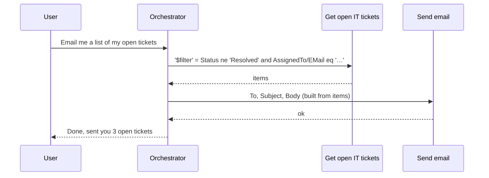

# 08 — Tools & connectors

This page explains [tools](glossary.md#tool) (things the agent can call to get work done), the `TaskDialog` files in
`actions/`. It covers the most common kind of tool, a [connector](glossary.md#connector) operation (a call to a
pre-built wrapper around an external API such as Outlook or [SharePoint](glossary.md#sharepoint), Microsoft's document and intranet service): its inputs and outputs, the
[connection references](glossary.md#connection-reference) that hold the credentials, and the quoting rules for
[OData](glossary.md#odata) parameters. It also covers how a [topic](glossary.md#topic) (a scripted conversation flow) calls a connector or a raw REST endpoint inline, and
how to use the bundled connector catalogues. MCP servers and other agents are covered in
[09 MCP & multi-agent](09-mcp-and-multi-agent.md); flows in [10 Flows](10-flows-and-autonomous-triggers.md).

## What a tool is

A tool is one file in `actions/`, `kind:` [TaskDialog](reference/schema/dialogs.md#taskdialog). (The folder is
called `actions/` because older [Copilot Studio](glossary.md#copilot-studio) versions called tools "actions"; see the
[glossary](glossary.md#action).) A tool has three parts:

- **What it is for**: `modelDisplayName` and `modelDescription`. The
  [orchestrator](glossary.md#orchestrator) (the LLM that plans each turn) reads these to decide when to call the tool.
- **Its parameters**: `inputs` (and `outputs`). The orchestrator fills automatic inputs from the conversation.
- **What actually runs**: the `action:` block, whose `kind:` is one of 10
  [TaskAction](reference/schema/task-actions.md#taskaction) kinds.

```yaml
# Name: Get my profile
# Description: Returns the signed-in user's Microsoft 365 profile
kind: TaskDialog
modelDisplayName: Get my profile
modelDescription: Returns the signed-in user's Microsoft 365 profile (name, job title, department, office location, country). Use when the user asks about their own profile details.
outputs:
  - propertyName: displayName
  - propertyName: jobTitle
  - propertyName: department
action:
  kind: InvokeConnectorTaskAction
  connectionReference: cr26e_myAgent.shared_office365users.7c1e2a
  connectionProperties:
    mode: Invoker
  operationId: MyProfile_V2
outputMode: All
```

Under [generative orchestration](glossary.md#generative-orchestration), the orchestrator calls tools directly. A
topic can also call a connector itself, without a tool file (see
[Inline connector calls in topics](#inline-connector-calls-in-topics)).

### TaskDialog root properties

| Property | Type / values | Req. | Meaning |
|---|---|---|---|
| `modelDisplayName` | string | | Name shown to the orchestrator (and in the UI). |
| `modelDescription` | string | | **The routing signal.** Say what the tool does, when to use it, and when not to. See [model description](glossary.md#model-description). |
| `inputs` | list of `AutomaticTaskInput` / `ManualTaskInput` | | Parameters. See [Inputs](#inputs-automatic-vs-manual). |
| `outputs` | list of `{propertyName, name?, description?}` | | Output properties exposed to the orchestrator. `propertyName` must match the operation's output schema. |
| `outputMode` | `All` (default) \| `Specific` | | The vendor guidance says "usually `All`: exports all operation outputs". *Inferred:* `Specific` limits the outputs to those listed in `outputs`. |
| `action` | one of the [10 action kinds](#the-10-action-kinds) | | What runs. |
| `triggerCondition` | `true` \| `false` \| `=` expression, default `true` | | No vendor guidance. *Inferred:* whether the tool is currently available to the orchestrator. |
| `confirmation` | `{activity, mode}` | | No vendor guidance. *Inferred:* a message asking the user to confirm before the tool runs. |
| `response` | `{activity, mode}` | | No vendor guidance. *Inferred:* a fixed message sent after the tool runs. |

## The 10 action kinds

| `action.kind` | Calls | More |
|---|---|---|
| [InvokeConnectorTaskAction](reference/schema/task-actions.md#invokeconnectortaskaction) | A connector operation (Outlook, SharePoint, [Dataverse](glossary.md#dataverse), a [custom connector](glossary.md#custom-connector), …) | [Below](#connector-tools-invokeconnectortaskaction) |
| [InvokeFlowTaskAction](reference/schema/task-actions.md#invokeflowtaskaction) | A [cloud flow](glossary.md#cloud-flow) or [agent flow](glossary.md#agent-flow), by `flowId` | [10 Flows](10-flows-and-autonomous-triggers.md) |
| [InvokeExternalAgentTaskAction](reference/schema/task-actions.md#invokeexternalagenttaskaction) | An [MCP](glossary.md#mcp) server, or an [external agent](glossary.md#external-agent) over [A2A](glossary.md#a2a) / the Activity protocol | [09 MCP & multi-agent](09-mcp-and-multi-agent.md) |
| [InvokeConnectedAgentTaskAction](reference/schema/task-actions.md#invokeconnectedagenttaskaction) | Another published Copilot Studio agent (a [connected agent](glossary.md#connected-agent)) | [09](09-mcp-and-multi-agent.md) |
| [InvokeAgentTaskAction](reference/schema/task-actions.md#invokeagenttaskaction) | An agent by `gptComponentSchemaName` | [09](09-mcp-and-multi-agent.md) |
| [InvokeAIPluginTaskAction](reference/schema/task-actions.md#invokeaiplugintaskaction) | An AI plugin operation (`entityKey`, with maker or invoker connection references) | No vendor guidance |
| [InvokeClientTaskAction](reference/schema/task-actions.md#invokeclienttaskaction) | An action carried out by the **client** (the chat host). Requires a `clientActionInputSchema` | No vendor guidance |
| [InvokeComputerUsingAgentTaskAction](reference/schema/task-actions.md#invokecomputerusingagenttaskaction) | A [computer-using agent](glossary.md#computer-using-agent) (one that drives a website or desktop app through its UI), with `instructions`, a `model` and an `allowlist` of websites and desktop apps | No vendor guidance |
| [InvokeAIBuilderModelTaskAction](reference/schema/task-actions.md#invokeaibuildermodeltaskaction) | An [AI Builder](glossary.md#ai-builder) model or prompt, by `aIModelId` | The vendor says to create these in the UI |
| [InvokeSkillTaskAction](reference/schema/task-actions.md#invokeskilltaskaction) | A [Bot Framework skill](glossary.md#bot-framework-skill) (a bot exposed as a callable sub-component), by `skillId` + `actionId` | No vendor guidance |

The vendor authoring rules say AI Builder prompt nodes and tools "involve [Power Platform](glossary.md#power-platform) components beyond YAML". You
can reference an existing one, but you can't create one in YAML.

## Connector tools (InvokeConnectorTaskAction)

The int-reference skill calls `InvokeConnectorTaskAction` "always" the kind for connector tools. A connector
operation is identified by an `operationId` (for example `GetItems` or `SendEmailV2`) on a connector (for example
`shared_sharepointonline`). The connector is reached through a connection reference.

```yaml
# fragment — the action: block of a connector tool
action:
  kind: InvokeConnectorTaskAction
  connectionReference: cr26e_myAgent.shared_office365.a91f3b   # logical name: copy, never invent
  connectionProperties:
    mode: Invoker                                            # Invoker | Maker
  operationId: SendEmailV2                                   # from the connector catalogue
```

| Property | Type / values | Req. | Meaning |
|---|---|---|---|
| `connectionReference` | string | ✓ | Logical name of the connection reference (see [Connection references](#connection-references)). **Never change it.** |
| `operationId` | string | ✓ | The connector operation. **Never change it**: to call a different operation, add a new tool. |
| `connectionProperties.mode` | `Maker` (default) \| `Invoker` | | Whose credentials are used. See [Maker vs Invoker](#maker-vs-invoker). |
| `requestTimeoutInMilliseconds` | int, default 30000 | | No vendor guidance. *Inferred:* call timeout. |
| `dynamicInputSchema`, `dynamicOutputSchema` | type definitions | | No vendor guidance. *Inferred:* resolved shapes for operations whose inputs or outputs depend on design-time choices (for example a SharePoint list's columns). |
| `toolAugmentation` | `kind: EnableToolAugmentation` \| `DisableToolAugmentation` | | No vendor guidance. |
| `aIPluginOperationExportKey` | string | | No vendor guidance. |

The vendor rules for editing an existing connector tool:

- **Never change** `action.operationId` or `action.connectionReference`. Changing either breaks the tool.
- **Input and output `propertyName`s must match the connector definition exactly.** Check them in the
  [catalogue](#finding-operations-connector-catalogues-and-connector-lookup).
- After changing `mode`, the user may have to reconfigure the connection in the portal.

## Inputs: automatic vs manual

Each entry in `inputs:` maps one operation parameter (`propertyName`) to a value source.

| Kind | Who supplies the value | Use when |
|---|---|---|
| [AutomaticTaskInput](reference/schema/task-actions.md#automatictaskinput) | The orchestrator, from the conversation. It asks the user only if it must. | The value depends on what the user said. |
| [ManualTaskInput](reference/schema/task-actions.md#manualtaskinput) | You, at design time (`value:`) | The value is fixed: a site URL, a list name, a time zone, a page size. |

```yaml
# fragment — a tool's inputs: list
inputs:
  - kind: AutomaticTaskInput
    propertyName: Subject
    description: A short subject line summarising the email   # the orchestrator reads this
    entity: StringPrebuiltEntity
    shouldPromptUser: true

  - kind: ManualTaskInput
    propertyName: Importance
    value: Normal
```

**AutomaticTaskInput properties**

| Property | Type / values | Req. | Meaning |
|---|---|---|---|
| `propertyName` | string | ✓ | The operation's input name, exactly as in the catalogue. |
| `description` | string | | Instructions to the orchestrator for filling the value. Be precise: give formats, allowed values and examples. |
| `shouldPromptUser` | boolean, default `true` | | If `true`, the orchestrator may ask the user when it can't infer the value. If `false`, it fills the value silently from context and doesn't ask (useful for classification-style inputs; see [13 Patterns](13-patterns.md#orchestrator-variables)). |
| `entity` | an [entity](glossary.md#entity) (a value type the recogniser can extract), for example `StringPrebuiltEntity`, `NumberPrebuiltEntity`, `EmailPrebuiltEntity` | | The type of value to extract. See [06 Entities](06-variables-entities-powerfx.md#entities). |
| `defaultValue` | value or `=` expression | | No vendor guidance. *Inferred:* the value used if none is found. |
| `inputSettings` | `prompt`, `repeatCount`, `validation`, `invalidPrompt`, … | | No vendor guidance. *Inferred:* customises the question asked to fill the input (same shape as a [Question](reference/schema/actions.md#question) node's settings). |
| `name` | string | | No vendor guidance. |

**ManualTaskInput properties**: `propertyName` ✓ and `value` ✓.

> **ManualTaskInput values: strings only (for connector tools).** The int-reference and edit-action skills both say
> a `ManualTaskInput` can only hardcode **strings**. If the parameter is a number, enum or complex type, write it as a
> string (`value: "50"`) and have the user check it in the UI after pushing. The schema itself accepts any value. For
> MCP tools, the vendor allows a [Power Fx](glossary.md#power-fx) (formula language) expression such as `value: =System.User.Email` (see
> [09](09-mcp-and-multi-agent.md#inputs-on-an-mcp-tool)).

### Outputs

`outputs:` lists the operation's output properties that the orchestrator can see. Each `propertyName` must exist in
the operation's output schema. Some operations, such as SharePoint `GetItems`, return
`UnresolvedDynamicType`: their columns depend on the specific list, so nobody (including an AI assistant) can know
the column names in advance. **Ask for the real column names** before you write outputs or filters (see
[`$`-prefixed inputs](#-prefixed-inputs-odata-parameters)).

## Connection references

A [connection](glossary.md#connection) is an authenticated session with a service (your Outlook mailbox, a
SharePoint [tenant](glossary.md#tenant)). A **connection reference** is a named pointer to a connection, stored in the
[solution](glossary.md#solution) (Power Platform's packaging unit). Tools name the reference
(`connectionReference: <logical name>`), so they never contain credentials and can be re-pointed when the agent
moves between [environments](glossary.md#environment).

The agent's references are listed in `connectionreferences.mcs.yml` at the agent root. The schema describes the file
as [ConnectionReferencesSourceFile](reference/schema/components.md#connectionreferencessourcefile), a list of
[ConnectionReference](reference/schema/components.md#connectionreference) entries. The vendor repo contains no sample
file, so the following shape is **inferred from the schema** and the values are placeholders:

```yaml
# fragment — inferred shape of connectionreferences.mcs.yml (no vendor sample exists)
connectionReferences:
  - id: 0b6f2a1e-4c3d-4e5f-8a9b-1c2d3e4f5a6b
    connectionReferenceLogicalName: cr26e_myAgent.shared_office365.a91f3b
    connectorId: /providers/Microsoft.PowerApps/apis/shared_office365
    displayName: Office 365 Outlook
```

Read this file to find the connector behind a tool (`connectorId`), and to copy a logical name you need elsewhere,
for example for an inline `InvokeConnectorAction`. **Don't hand-author new entries.**

### Adding a connector tool: add in the UI, then pull

You **can't create** a connection reference in YAML. Creating one requires a person to sign in to the service in the
Copilot Studio portal. So the vendor `add-action` skill doesn't write new connector tools at all. Its workflow is:

1. **Find the operation** in the [catalogue](#finding-operations-connector-catalogues-and-connector-lookup), so you
   know its display name, `operationId` and inputs.
2. **Add it in the UI.** Open Copilot Studio → your agent → **Tools** (older UI: **Actions**) → **+ Add** → search
   for the operation's display name → choose the connector → **sign in / create the connection** → save.
3. **Pull** the agent ([VS Code extension](glossary.md#vs-code-extension) *Pull*, or `manage-agent pull`). You now have a new `actions/*.mcs.yml`
   file and an updated `connectionreferences.mcs.yml`.
4. **Edit the YAML freely**: improve `modelDescription` and input descriptions, switch inputs between automatic and
   manual, add or remove inputs and outputs, change `mode`. Then validate and push.

If the connector you need isn't in the bundled catalogues, do the same steps. You'll just have to get the operation
details from the UI instead.

## Maker vs Invoker

`connectionProperties.mode` decides **whose identity** the call runs as. See
[maker and invoker credentials](glossary.md#maker-and-invoker-credentials).

| Mode | Credentials | Typical use |
|---|---|---|
| `Maker` (schema default) | The agent author's connection, shared by every user | Shared resources that every user may see, such as a public list or a service account mailbox |
| `Invoker` | **Each end user signs in** with their own account | Personal data (mail, calendar, files, profile); anything where users must only see what they're allowed to |

Invoker mode needs the agent to have user authentication configured. The JIT-user-context pattern notes that
without it, connector calls fail (silently, in that pattern's case). See [03 The agent](03-agent.md).

## `$`-prefixed inputs (OData parameters)

Some connectors, notably SharePoint, take OData query options named `$filter`, `$orderby` and `$top`. (OData is a
REST query convention; see [OData](glossary.md#odata).) How you spell these names **depends on where you write
them**. This is one of the most common runtime failures.

**In a TaskDialog tool (`actions/*.mcs.yml`)**, the `propertyName` must be the literal string `'$filter'`, single
quotes included. So in YAML you wrap it in double quotes as well:

```yaml
# fragment — TaskDialog inputs (correct)
inputs:
  - kind: ManualTaskInput
    propertyName: "'$filter'"
    value: "Status eq 'Active'"

  - kind: AutomaticTaskInput
    propertyName: "'$orderby'"
    description: The OData orderBy clause, e.g. Created desc or Title asc

  - kind: ManualTaskInput
    propertyName: "'$top'"
    value: "50"
```

The outer `"…"` are YAML string delimiters. The inner `'…'` are part of the value the runtime matches. All of
these **fail at runtime**:

| Written as | Problem |
|---|---|
| `propertyName: $filter` | Bare `$`: YAML may misparse it, and the runtime won't match it |
| `propertyName: "$filter"` | Double quotes only: the runtime won't match |
| `propertyName: '$filter'` | Single quotes only: these are YAML delimiters, so the value is `$filter` and the runtime won't match |
| `propertyName: filter` | Missing `$` |

**In an inline `InvokeConnectorAction` (inside a topic)**, use the `parameters/` prefix and **no** inner quotes:
`parameters/$filter`. Never mix the two forms. (See the next section for where the key goes.)

### Writing the filter value

The value is **OData v4** syntax, not SQL, JavaScript or Power Fx:

| Use | Not | Example |
|---|---|---|
| `eq`, `ne`, `gt`, `lt`, `ge`, `le` | `==`, `!=`, `>`, … | `Priority gt 3` |
| `and`, `or`, `not(...)` | `&&`, `\|\|`, `!` | `Status eq 'Active' and Priority gt 3` |
| `'single quotes'` for strings | `"double"`, or unquoted | `Title eq 'My Document'` |
| ISO 8601 dates in quotes | `'2026-01-01'` | `Created ge '2026-01-01T00:00:00Z'` |
| Unquoted numbers and booleans | | `IsActive eq true` |
| **Internal** column names | Display names | `Employee_x0020_Name eq 'x'`, not `Employee Name eq 'x'` |
| `startswith(Title,'Proj')`, `substringof('urgent',Title)` | | |

**Person/Group columns** (Assigned To, Created By = `Author`, Modified By = `Editor`) must be filtered by the `EMail`
sub-property: `AssignedTo/EMail eq 'john.doe@contoso.com'`. Filtering on `DisplayName` or `Title` returns nothing,
because those aren't filterable. To filter by "me", first look up the user's email (the `mail` field) with the
Office 365 Users connector, then build the filter. The catalogue's operation for this is `MyProfile_V2`, *Get my
profile (V2)*. The vendor examples use `UserGet_V2`; see the note under
[Inline connector calls](#inline-connector-calls-in-topics).

**Discover the columns first.** An AI assistant can't guess a list's internal column names, types or choice values.
Run `GetItems` once with `'$top'` = `1` and no filter (for example in the Copilot Studio test pane), and read the
JSON. Then put the exact column names and allowed values into the `'$filter'` input's description.

### Which SharePoint inputs should be manual

| Operation | Parameter | Recommended | Why |
|---|---|---|---|
| `GetItems`, `GetFileItems` | `dataset` (site address) | Manual | The orchestrator will invent URLs |
| | `table` (list/library name) | Manual | The orchestrator can't discover list names |
| | `'$filter'` | Manual if fixed; Automatic if it depends on the conversation (with a very precise description) | |
| | `'$orderby'`, `'$top'` | Manual | Usually fixed |
| `PostItem`, `PatchItem` | `dataset`, `table` | Manual | Fixed |
| | `item` | Automatic | Describe the exact column names and types |

## Inline connector calls in topics

A topic can call a connector operation directly with the
[InvokeConnectorAction](reference/schema/actions.md#invokeconnectoraction) node. You don't need a tool file, and the
orchestrator isn't involved. Use it for **deterministic** calls the orchestrator shouldn't be choosing, such as
loading the user's profile when a conversation starts.

| | `TaskDialog` tool | `InvokeConnectorAction` node |
|---|---|---|
| File | `actions/*.mcs.yml` | A node inside a topic's `actions:` |
| Who decides to call it | The orchestrator, from `modelDescription` | Your topic logic, always |
| Inputs | `inputs:` list (`AutomaticTaskInput`/`ManualTaskInput`) | `input:` binding with Power Fx values |
| Outputs | `outputs:`, which go to the orchestrator | `output:` bound to [topic variables](glossary.md#topic-variable) |
| OData names | `"'$filter'"` | `parameters/$filter` |

This example, from the vendor `conversation-init` template and the JIT-user-context pattern, loads the signed-in
user's Microsoft 365 profile on the first message (see [13 Patterns](13-patterns.md#jit-user-context)):

```yaml
# two nodes from an OnActivity topic
- kind: InvokeConnectorAction
  id: getProfile_Jt8kQ1
  connectionReference: shared_office365users
  connectionProperties:
    mode: Invoker
  operationId: UserGet_V2
  output:
    kind: SingleVariableOutputBinding
    variable: init:Topic.M365Profile

- kind: SetVariable
  id: setCountry_Jt8kQ1
  variable: Global.UserCountry
  value: =If(IsBlank(Topic.M365Profile.country), "Unknown", Topic.M365Profile.country)
```

(Here the vendor writes `connectionReference: shared_office365users`, which is the connector's API name. Elsewhere, connection references are logical names such as
`cr26e_myAgent.shared_office365users.7c1e2a`. The vendor examples are inconsistent here. Use whatever your
`connectionreferences.mcs.yml` contains.)

> **Operation ID mismatch.** The vendor template and patterns call `UserGet_V2`, but the bundled
> [Office 365 Users catalogue](reference/connectors/shared_office365users.md) has no such operation. Its "current
> user" operation is `MyProfile_V2`, which returns `mail`, `country`, `department` and other fields. Check the
> operation ID in the UI before relying on either.

| Property | Type / values | Req. | Meaning |
|---|---|---|---|
| `id` | string | ✓ | Node ID. |
| `connectionReference` | string | ✓ | As for tools. |
| `operationId` | string | ✓ | As for tools. |
| `connectionProperties.mode` | `Maker` \| `Invoker` | | As for tools. |
| `input` | `binding:` map of parameter name → value/expression | | Inputs to the operation. |
| `output` | `kind: SingleVariableOutputBinding` + `variable:` (the whole response), or `binding:` map of output name → variable | | Where results go. |
| `errorHandling` | see [HTTP error handling](#error-handling) | | What to do when the call fails. |
| `requestTimeoutInMilliseconds` | int, default 30000 | | Timeout. |

### Where the input parameters go

> **Source vs schema.** The vendor skills (`int-reference`, `sharepoint-actions.md`, `knowledge-guide.md`) write
> inputs **directly** under `input:`, for example `input: { parameters/$filter: … }`. The schema rejects that: in
> [ActionInputBindingBase](reference/schema/actions.md#actioninputbindingbase), `input:` must be a `binding:` map
> (or a `SingleValueInputBinding`). The schema-valid form is below. The key spelling `parameters/<name>` comes from
> the vendor skills. The schema only says the keys are names, so confirm the spelling against a call configured in
> the UI.

```yaml
- kind: InvokeConnectorAction
  id: getMyTasks_g7Hi89
  connectionReference: cr26e_myAgent.shared_sharepointonline.4f2a9c
  connectionProperties:
    mode: Invoker
  operationId: GetItems
  input:
    binding:
      parameters/dataset: https://contoso.sharepoint.com/sites/Projects
      parameters/table: Tasks
      parameters/$filter: ="AssignedTo/EMail eq '" & Topic.UserEmail & "'"
  output:
    kind: SingleVariableOutputBinding
    variable: init:Topic.MyTasks
```

## HTTP requests from a topic (HttpRequestAction)

To call a REST endpoint that has no connector, use the
[HttpRequestAction](reference/schema/actions.md#httprequestaction) node in a topic.

> **Thin sources.** The vendor skills don't use or describe `HttpRequestAction`. Everything in this section comes from
> the schema, and the behaviour described is inferred from property names. Validate, then test in the Copilot Studio
> test pane.

```yaml
- kind: HttpRequestAction
  id: httpRequest_Tk3t9P
  method: Post
  url: https://api.contoso.com/v1/tickets
  headers:
    Content-Type: application/json
    Authorization: ="Bearer " & Global.ApiToken
  body:
    kind: JsonRequestContent
    content: "={ title: Topic.Title, priority: Topic.Priority }"
  requestTimeoutInMilliseconds: 10000
  response: Topic.TicketResponse
  responseSchema:
    kind: Record
    properties:
      id: String
      status: String
  errorHandling:
    kind: ContinueOnErrorBehavior
    statusCode: Topic.HttpStatus
    errorResponseBody: Topic.HttpError
```

| Property | Type / values | Req. | Meaning (inferred) |
|---|---|---|---|
| `url` | string or `=` expression | ✓ | Request URL. |
| `method` | `Get` (default) \| `Post` \| `Patch` \| `Put` \| `Delete`, or `=` expression | | HTTP method. |
| `headers` | map of name → string or `=` expression | | Request headers. |
| `body` | one of the content kinds below | | Request body. |
| `response` | variable name | | Variable that receives the parsed response body. |
| `responseSchema` | a data type (for example `kind: Record` with `properties:`) | | Declares the response's shape, so that fields such as `Topic.TicketResponse.id` are typed. |
| `responseHeaders` | variable name | | Variable that receives the response headers. |
| `errorHandling` | see below | | Failure behaviour. |
| `requestTimeoutInMilliseconds` | int, default 30000 | | Timeout. |
| `networkIsolation` | `PublicNetwork` \| `VirtualNetwork` | | Network route. |

**Request content kinds** (`body.kind`):

| Kind | Properties | Use for |
|---|---|---|
| [NoRequestContent](reference/schema/actions.md#norequestcontent) | — | No body (typical for `Get`/`Delete`) |
| [JsonRequestContent](reference/schema/actions.md#jsonrequestcontent) | `content`: a value or a Power Fx record/table | JSON bodies |
| [RawRequestContent](reference/schema/actions.md#rawrequestcontent) | `contentType`, `content` (string or expression) | Anything else, such as form-encoded data, XML or plain text |

### Error handling

`errorHandling` appears on `HttpRequestAction`, `InvokeConnectorAction` and `WaitForConnectorTrigger`:

| Kind | Behaviour (inferred) |
|---|---|
| [RaiseErrorBehavior](reference/schema/actions.md#raiseerrorbehavior) (or omit `errorHandling`) | A failed call raises an error. The topic stops and the agent's `OnError` topic runs (see [04 Topics & triggers](04-topics-and-triggers.md)). |
| [ContinueOnErrorBehavior](reference/schema/actions.md#continueonerrorbehavior) | The topic continues. `statusCode` and `errorResponseBody` name variables that receive the HTTP status and error body, so you can branch on them with a `ConditionGroup`. |

Don't put secrets in literal headers. Keep them out of YAML (for example in an
[environment variable](glossary.md#environment-variable) read at runtime), because agent YAML is meant to be
committed to source control.

## Finding operations: connector catalogues and connector-lookup

The skills repo bundles complete operation catalogues for four connectors. These docs render them as
[connector reference pages](reference/connectors/index.md):

| Connector | API name | Operations |
|---|---|---|
| [Office 365 Outlook](reference/connectors/shared_office365.md) | `shared_office365` | 88 |
| [Office 365 Users](reference/connectors/shared_office365users.md) | `shared_office365users` | 6 |
| [SharePoint](reference/connectors/shared_sharepointonline.md) | `shared_sharepointonline` | 53 |
| [Azure DevOps](reference/connectors/shared_visualstudioteamservices.md) | `shared_visualstudioteamservices` | 26 |

The Office 365 Users and Outlook connectors call [Microsoft Graph](glossary.md#microsoft-graph) (the Microsoft 365 data API) behind the scenes. Whether a connector may be used at all in an environment is decided by admin [DLP](glossary.md#dlp) (data loss prevention) policies, so a tool whose YAML is valid can still be blocked at runtime.

How to read a catalogue page:

- The **Operations** table lists each `operationId`, its UI display name (what you search for when adding the tool in
  the portal) and a description.
- Each operation's **Inputs** table gives the input **Name**, which is exactly what goes in `propertyName`, plus the
  display name, type and whether it's required. Tags such as *advanced* (hidden by default in the UI) and *values
  looked up dynamically* (the UI offers a picker, so you need a real value) are hints.
- **Output** is either a type (`String`), a record or table of fields (which you can list in `outputs:`), or
  `UnresolvedDynamicType` (the shape depends on design-time choices).
- **Triggers** are [connector triggers](glossary.md#connector-trigger): events that start flows or [autonomous agents](glossary.md#autonomous-agent), not tools. See
  [10](10-flows-and-autonomous-triggers.md#connector-triggers).
- Versioned operations (`SendEmail` → `SendEmailV2`) coexist. Prefer the highest non-deprecated version.

The same data is available from the command line through the vendor's `connector-lookup` script (it runs offline and
reads `reference/connectors/*.yml`):

```bash
# from vendor/skills-for-copilot-studio
node scripts/connector-lookup.bundle.js list                          # connectors and operation counts
node scripts/connector-lookup.bundle.js operations sharepoint         # all operations of one connector
node scripts/connector-lookup.bundle.js operation sharepoint GetItems # inputs/outputs of one operation
node scripts/connector-lookup.bundle.js search email                  # search names + descriptions
```

`<connector>` matches the API name exactly, then part of the API name, then part of the display name (so `outlook`
finds `shared_office365`). `search` does a plain substring match on each operation's display name and description,
so multi-word phrases are literal: `search "send email"` finds only *Send email with options*, while `search email`
finds every email operation. If a connector isn't in the list, use the Copilot Studio UI to find its operations.

## Worked example: SharePoint and Outlook tools

Goal: an IT helpdesk agent that can (1) list a user's open tickets from a SharePoint list and (2) email a summary.
The operation and input names below are copied from the catalogues
([GetItems](reference/connectors/shared_sharepointonline.md#getitems),
[SendEmailV2](reference/connectors/shared_office365.md#sendemailv2)). **The `connectionReference` values are
illustrative.** Yours will be whatever the UI created (see
[add in the UI, then pull](#adding-a-connector-tool-add-in-the-ui-then-pull)).

### 1. Get open tickets (SharePoint `GetItems`)

From the catalogue, `GetItems` takes `dataset` ✓, `table` ✓, `$filter`, `$orderby`, `$top`, `folderPath`,
`viewScopeOption` and `view`. Its output is `UnresolvedDynamicType`. The list's columns (confirmed by running
`GetItems` with `'$top'` = 1) are `Title`, `Status` (choice: New, In Progress, Resolved) and `AssignedTo` (person).

```yaml
# Name: Get open IT tickets
# Description: Lists open tickets from the IT Tickets SharePoint list
kind: TaskDialog
modelDisplayName: Get open IT tickets
modelDescription: Lists IT helpdesk tickets from the IT Tickets SharePoint list. Use when the user asks about their tickets or ticket status. Do not use to create or update tickets.
inputs:
  - kind: ManualTaskInput
    propertyName: dataset
    value: https://contoso.sharepoint.com/sites/IT

  - kind: ManualTaskInput
    propertyName: table
    value: IT Tickets

  - kind: AutomaticTaskInput
    propertyName: "'$filter'"
    description: |-
      OData filter for the IT Tickets list.
      Columns: Title (text), Status (choice: New, In Progress, Resolved), AssignedTo (person).
      Filter people by email only: AssignedTo/EMail eq 'user@contoso.com'.
      String values in single quotes; operators eq, ne, and, or.
      Default when the user asks for "my open tickets": Status ne 'Resolved' and AssignedTo/EMail eq '<user email>'.
    entity: StringPrebuiltEntity
    shouldPromptUser: false

  - kind: ManualTaskInput
    propertyName: "'$orderby'"
    value: Created desc

  - kind: ManualTaskInput
    propertyName: "'$top'"
    value: "25"

action:
  kind: InvokeConnectorTaskAction
  connectionReference: cr26e_myAgent.shared_sharepointonline.4f2a9c
  connectionProperties:
    mode: Invoker
  operationId: GetItems

outputMode: All
```

Notes:

- `dataset` and `table` are manual, so the orchestrator can't invent a site or list.
- `mode: Invoker`: each user only sees tickets their own SharePoint permissions allow.
- `'$top'` is a `Number` in the catalogue but is written as the string `"25"`, because ManualTaskInput values are
  strings.
- For the filter to use the user's email, the email has to be in the orchestrator's context. For example, load it
  into a [global variable](glossary.md#global-variable) marked `aIVisibility: UseInAIContext` (see [13 Patterns](13-patterns.md#jit-user-context)).

### 2. Email a summary (Outlook `SendEmailV2`)

From the catalogue, `SendEmailV2` takes `To` ✓, `Subject` ✓ and `Body` ✓, plus optional `From`, `Cc`, `Bcc`,
`Attachments`, `Sensitivity`, `ReplyTo` and `Importance`. Its output is a `String`.

```yaml
# Name: Send email
# Description: Sends an email from the signed-in user's mailbox
kind: TaskDialog
modelDisplayName: Send an email
modelDescription: Sends an email from the user's own Outlook mailbox. Use only when the user explicitly asks to email something; confirm the recipients and content with the user first.
inputs:
  - kind: AutomaticTaskInput
    propertyName: To
    description: Recipient email addresses separated by semicolons, e.g. someone@contoso.com
    entity: StringPrebuiltEntity
    shouldPromptUser: true

  - kind: AutomaticTaskInput
    propertyName: Subject
    description: A short subject line summarising the email
    entity: StringPrebuiltEntity
    shouldPromptUser: true

  - kind: AutomaticTaskInput
    propertyName: Body
    description: The email body in HTML. Use <p> and <ul><li> for structure.
    entity: StringPrebuiltEntity
    shouldPromptUser: true

  - kind: ManualTaskInput
    propertyName: Importance
    value: Normal

action:
  kind: InvokeConnectorTaskAction
  connectionReference: cr26e_myAgent.shared_office365.a91f3b
  connectionProperties:
    mode: Invoker
  operationId: SendEmailV2

outputMode: All
```

`mode: Invoker` makes the mail come from the user, not from the agent's author. For mail that should come from a
service mailbox, use `Maker` with a connection owned by that mailbox, or the catalogue's `SharedMailboxSendEmailV2`.

### Flow of a turn



## Related gotchas

- **Raw tool-call JSON reaching the user.** The orchestrator sometimes leaks internal fields such as
  `explanation_of_tool_call`. There are two mitigations: an output rule in the instructions, or an
  `OnGeneratedResponse` topic that suppresses those messages. See
  [13 Patterns — Prevent tool call leaks](13-patterns.md#prevent-tool-call-leaks).
- **Vague `modelDescription`s** cause wrong or missing tool calls. Describe when to use the tool *and* when not to.
- **Connector not pre-configured.** An inline call to a connector whose connection was never set up in the UI fails
  at runtime.
- More in [14 Gotchas](14-gotchas.md).

## Sources

- `vendor/skills-for-copilot-studio/skills/add-action/SKILL.md`: UI-then-pull workflow, connector lookup, MCP differences
- `vendor/skills-for-copilot-studio/skills/edit-action/SKILL.md`: editable fields, input kinds, Maker/Invoker, rules
- `vendor/skills-for-copilot-studio/skills/edit-action/sharepoint-actions.md`: `$`-prefixed names, OData syntax, SharePoint input recommendations, person filters
- `vendor/skills-for-copilot-studio/skills/int-reference/SKILL.md`: action structure, input types, OData quoting
- `vendor/skills-for-copilot-studio/templates/actions/connector-action.mcs.yml`
- `vendor/skills-for-copilot-studio/templates/topics/conversation-init.topic.mcs.yml`: inline `InvokeConnectorAction`
- `vendor/skills-for-copilot-studio/scripts/src/connector-lookup.js` and `reference/connectors/*.yml`
- `vendor/skills-for-copilot-studio/patterns/jit-user-context.md`, `patterns/prevent-tool-call-leaks.md`
- `vendor/skills-for-copilot-studio/agents/copilot-studio-author.md`: UI-only limitations
- Generated reference: [task-actions.md](reference/schema/task-actions.md), [dialogs.md](reference/schema/dialogs.md#taskdialog), [actions.md](reference/schema/actions.md), [connector catalogues](reference/connectors/index.md)
