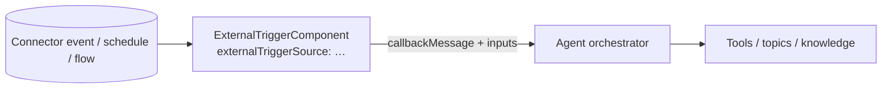

# 10 — Flows & autonomous triggers

This page covers two related things. The first is **workflows**: [Power Automate](glossary.md#power-automate) (the
[Power Platform](glossary.md#power-platform)'s workflow-automation service) [cloud flows](glossary.md#cloud-flow) and
[Copilot Studio](glossary.md#copilot-studio) [agent flows](glossary.md#agent-flow), called from a topic or used as a
tool. The second is **autonomous triggers**: events and schedules that start the agent without a user
typing anything.

> **Read this first: most of this page is schema structure only.** The skills repo has almost no prose about flows
> or autonomous triggers. Here is what it does say:
>
> - Autonomous triggers "require Power Platform config beyond YAML". The author agent refuses to create them and
>   tells users to configure them in the Copilot Studio UI. You may **edit or reference** existing ones.
> - For full [SharePoint](glossary.md#sharepoint) file content, use an agent flow with the [connector](glossary.md#connector)'s
>   *Get file content* operation, "then
>   call the flow from topics".
>
> Everything else here (every YAML shape and property) comes from the JSON schema. Where behaviour is described, it
> is **inferred from property names** and marked as such. GUIDs are placeholders. Use these shapes to *read and
> safely edit* what you pull from Copilot Studio, not as a recipe for creating these components from scratch.

## Flows in one minute

A cloud flow is a deterministic workflow: **a trigger** ("when called by an agent", "when
a new email arrives", "every day at 9:00") **followed by steps** (call a connector
operation, loop, branch, send an approval, transform data). Flows are built in a visual designer, not in agent YAML.
An agent sees a flow only through its **inputs and outputs**.

There are two kinds you'll meet:

| | Power Automate cloud flow | Agent flow |
|---|---|---|
| Built in | Power Automate | Copilot Studio |
| Stored in | The [solution](glossary.md#solution) (Power Platform's packaging unit) / [Dataverse](glossary.md#dataverse) (the Power Platform database) | Same |
| Called from the agent with | `InvokeFlowAction` (topic) or `InvokeFlowTaskAction` (tool) | Same |

**Why call a flow instead of a connector directly?** Use one when the work is multi-step and must be exactly
repeatable. Examples: create a record, then email an approver, then wait for approval. Or fetch an entire file
rather than search chunks of it. Or handle long-running work. A single connector call is simpler as a tool (see
[08](08-tools-and-connectors.md)).

**The flow itself can't be created in YAML.** Build it in Power Automate or Copilot Studio, give it an agent/Copilot
trigger with typed inputs and outputs, and then reference its ID from YAML.

## Calling a flow from a topic

The [InvokeFlowAction](reference/schema/actions.md#invokeflowaction) [node](glossary.md#node) (a topic step) runs a flow at a fixed
point in a [topic](glossary.md#topic), passes inputs, and stores outputs in variables:

```yaml
# Name: Create IT ticket
kind: AdaptiveDialog
modelDescription: Creates an IT support ticket when the user reports a broken device or software problem.
inputs:
  - kind: AutomaticTaskInput
    propertyName: IssueSummary
    description: One-sentence summary of the user's problem

beginDialog:
  kind: OnRecognizedIntent
  id: main
  intent: {}
  actions:
    - kind: InvokeFlowAction
      id: invokeFlow_Tk7cR2
      flowId: 11111111-2222-3333-4444-555555555555     # placeholder: the flow's ID
      input:
        binding:
          summary: =Topic.IssueSummary                 # flow input name → value
          requesterEmail: =System.User.Email
      output:
        binding:
          ticketNumber: Topic.TicketNumber             # flow output name → variable

    - kind: SendActivity
      id: sendActivity_Tk7cR3
      activity: "Created ticket {Topic.TicketNumber}."

inputType:
  properties:
    IssueSummary:
      displayName: IssueSummary
      description: One-sentence summary of the user's problem
      type: String

outputType: {}
```

| Property | Type / values | Req. | Meaning |
|---|---|---|---|
| `id` | string | ✓ | Node ID. |
| `flowId` | string | ✓ | The flow to run. *Inferred:* the flow's workflow ID (the GUID Power Automate shows), which matches `workflowId` in [CloudFlowDefinition](#the-cloudflowdefinition-component). |
| `input` | `binding:` map of flow-input name → value or `=` expression | | Values for the flow's inputs. *Inferred:* the keys are the input names declared by the flow's trigger. |
| `output` | `binding:` map of flow-output name → variable, or `kind: SingleVariableOutputBinding` + `variable:` | | Where outputs go. |
| `latencyMessageSettings` | | | *Inferred:* "please wait" message for slow flows. |
| `displayName`, `disabled` | | | Canvas label; skip the node. |

The same `input`/`output` binding shapes are used by `BeginDialog`, `InvokeConnectorAction` and other call nodes.
See [05 Nodes](05-nodes.md#input-and-output-bindings).

## A flow as a tool

To let the [orchestrator](glossary.md#orchestrator) (the LLM planner) decide when to run a flow, wrap it in a
[tool](glossary.md#tool): a `TaskDialog` in `actions/` whose action is
[InvokeFlowTaskAction](reference/schema/task-actions.md#invokeflowtaskaction). Its only property is the required
`flowId`.

```yaml
# Name: Create IT ticket (flow)
# Description: Creates an IT support ticket through the ticketing flow
kind: TaskDialog
modelDisplayName: Create IT ticket
modelDescription: Creates an IT support ticket for a broken device or software problem and returns the ticket number. Do not use for password resets.
inputs:
  - kind: AutomaticTaskInput
    propertyName: summary
    description: One-sentence summary of the user's problem
outputs:
  - propertyName: ticketNumber
    description: The new ticket's number
action:
  kind: InvokeFlowTaskAction
  flowId: 11111111-2222-3333-4444-555555555555
```

*Inferred:* `inputs[].propertyName` and `outputs[].propertyName` must match the flow's declared input and output
names, as connector tools must match an operation's parameter names. In practice, add the flow as a tool in the
Copilot Studio UI, pull, and then edit the descriptions. See
[08 Tools & connectors](08-tools-and-connectors.md#adding-a-connector-tool-add-in-the-ui-then-pull) for that
workflow.

| Topic node (`InvokeFlowAction`) | Tool (`InvokeFlowTaskAction`) |
|---|---|
| Always runs at that point in the topic | The orchestrator decides from `modelDescription` |
| You bind inputs with [Power Fx](glossary.md#power-fx) (the formula language) | The orchestrator fills `AutomaticTaskInput`s from the conversation |
| Outputs go into [topic variables](glossary.md#topic-variable) | Outputs go back to the orchestrator |

## The CloudFlowDefinition component

[CloudFlowDefinition](reference/schema/components.md#cloudflowdefinition) is how the schema describes a flow that
belongs to the agent's solution: an identity plus an input/output contract. It isn't one of the files in the
standard clone layout ([02](02-project-layout.md#folder-structure)). The schema uses it inside solution and bot
definitions, so treat it as **read-only metadata**: you won't normally write one by hand.

```yaml
kind: CloudFlowDefinition
displayName: Create IT ticket
workflowId: 11111111-2222-3333-4444-555555555555
triggerType: Copilot
connectionType: InvokerOnly
inputType:
  properties:
    summary:
      type: String
    requesterEmail:
      type: String
outputType:
  properties:
    ticketNumber:
      type: String
```

| Property | Type / values | Req. | Meaning (inferred) |
|---|---|---|---|
| `workflowId` | string | ✓ | The flow's ID. This is what `flowId` refers to. |
| `displayName` | string | | Flow name. |
| `inputType` / `outputType` | record types | | The flow's inputs and outputs, as the agent sees them. |
| `triggerType` | `Standard` (default) \| `Copilot` | | `Copilot` presumably marks a flow with an agent ("run from Copilot") trigger. |
| `connectionType` | `EmbeddedOnly` \| `InvokerOnly` \| `EmbeddedAndInvoker` \| `NoConnections` | | Whose connections the flow's steps use: connections embedded by the author, the invoking user's, both, or none. Compare [maker and invoker credentials](glossary.md#maker-and-invoker-credentials). |
| `isEnabled` | boolean, default `true` | | Whether the flow is on. |
| `secureInputs` / `secureOutputs` | boolean, default `false` | | Hide inputs or outputs from run history. |

## Autonomous agents and event triggers

An [autonomous agent](glossary.md#autonomous-agent) runs without a user starting the chat. An **event** wakes it up,
hands it a payload and a message, and the agent uses its instructions, tools and knowledge to act. Typical events
are a new email, a SharePoint item created, a Dataverse row changed, or a schedule.



> **Create these in the UI.** Add the trigger in the agent's triggers section in Copilot Studio, pick the event,
> and sign in to its connection. (The vendor repo doesn't give the UI steps.) This creates the [connection reference](glossary.md#connection-reference) and the underlying Power Platform
> resources, which YAML can't create. Edit afterwards if needed. The vendor author agent refuses to scaffold
> autonomous triggers for this reason.

### ExternalTriggerComponent

[ExternalTriggerComponent](reference/schema/components.md#externaltriggercomponent) is the component that represents
one autonomous trigger. Its required properties are `schemaName` and `configuration`. The trigger itself is
`configuration.externalTriggerSource`, which is one of the three
[ExternalTriggerDefinition](reference/schema/components.md#externaltriggerdefinition) kinds. The vendor repo doesn't
say where these components appear in a cloned folder.

| `externalTriggerSource.kind` | Fires on | Required | Optional |
|---|---|---|---|
| [ConnectorTriggerDefinition](reference/schema/components.md#connectortriggerdefinition) | A [connector trigger](glossary.md#connector-trigger) (an event a connector exposes, such as a new email) | `connectionReference`, `triggerId`, `callbackMessage` | `connectionProperties` (`mode`, …), `inputs` |
| [RecurrenceTriggerDefinition](reference/schema/components.md#recurrencetriggerdefinition) | A schedule | `callbackMessage` | `inputs`, `mode` (`Maker` default / `Invoker`) |
| [WorkflowExternalTrigger](reference/schema/components.md#workflowexternaltrigger) | A flow that triggers the agent | `flowId` | — |

*Inferred meanings:* `callbackMessage` is the message the agent receives when the trigger fires (its "prompt" for
the run). `inputs` (`AutomaticTaskInput`/`ManualTaskInput`) pass trigger parameters or fixed values. `triggerId` is
the connector's trigger ID from the [catalogues](#connector-triggers). `RecurrenceTriggerDefinition` has **no
schedule fields** (the schema's `RecurrenceFrequency` enum, `Minute`…`Year`, isn't referenced by any definition), so
the schedule itself is presumably held in the underlying flow, outside the agent YAML.

**Connector trigger** (new email in Outlook; the connection reference is illustrative):

```yaml
kind: ExternalTriggerComponent
schemaName: cr26e_myAgent.ExternalTriggerComponent.NewSupportEmail
displayName: When a new support email arrives
configuration:
  externalTriggerSource:
    kind: ConnectorTriggerDefinition
    connectionReference: cr26e_myAgent.shared_office365.a91f3b
    connectionProperties:
      mode: Maker
    triggerId: OnNewEmailV3
    callbackMessage: A new email arrived in the support mailbox. Classify it, create a ticket if needed, and reply to the sender.
    inputs:
      - kind: ManualTaskInput
        propertyName: folderPath
        value: Inbox
```

(`folderPath` is an input of the Outlook *When a new email arrives (V3)* trigger in the vendor's connector YAML. The
`schemaName` pattern is a placeholder: no source documents it.)

**Schedule:**

```yaml
kind: ExternalTriggerComponent
schemaName: cr26e_myAgent.ExternalTriggerComponent.DailyDigest
displayName: Daily digest
configuration:
  externalTriggerSource:
    kind: RecurrenceTriggerDefinition
    mode: Maker
    callbackMessage: Compile yesterday's unresolved tickets and post a summary to the IT channel.
```

**Flow-driven:**

```yaml
kind: ExternalTriggerComponent
schemaName: cr26e_myAgent.ExternalTriggerComponent.FromFlow
configuration:
  externalTriggerSource:
    kind: WorkflowExternalTrigger
    flowId: 66666666-7777-8888-9999-000000000000
```

### AutonomousSettings

[AutonomousSettings](reference/schema/settings.md#autonomoussettings) is one of the agent settings kinds. Its only
property is `enterpriseKnowledgeConnectionReference` (string). There's no vendor guidance. *Inferred:* the connection
an autonomous run uses for enterprise knowledge search, which is needed because no user is signed in. See
[03 The agent](03-agent.md#settingsmcsyml).

### ActivateExternalTrigger node

[ActivateExternalTrigger](reference/schema/actions.md#activateexternaltrigger) is a topic node with a required
`dialog`, plus `externalTriggerId`, `input` (binding) and `activityProcessed` (default `true`). There's no vendor
guidance. *Inferred:* it switches on an external trigger from within a conversation and names the topic (`dialog`)
that handles it when it fires. One use would be "notify me when this item changes".

```yaml
# fragment — schema shape only, no vendor example
- kind: ActivateExternalTrigger
  id: activateTrigger_Nt5f1Y
  dialog: cr26e_myAgent.topic.HandleItemChanged
  externalTriggerId: <id of the external trigger component>
  input:
    binding:
      itemId: =Topic.ItemId
```

### Topic triggers for scheduled and connector events

Three [topic trigger](glossary.md#trigger) kinds handle these events inside a topic. Their shapes are summarised in
[04 Topics & triggers](04-topics-and-triggers.md#scheduled-and-connector-triggers):

| `beginDialog.kind` | Fires when (inferred) | Extra properties |
|---|---|---|
| [RecurrenceTrigger](reference/schema/triggers.md#recurrencetrigger) | A scheduled run starts | none beyond `id`, `condition`, `priority`, `runOnce`, `actions` |
| [CreateConversationConnectorTrigger](reference/schema/triggers.md#createconversationconnectortrigger) | A connector event **starts a new conversation** | `connectionReference` ✓, `connectorTriggerId` ✓, `connectionProperties`, `dynamicInputSchema`, `dynamicOutputSchema` |
| [ContinueConversationConnectorTrigger](reference/schema/triggers.md#continueconversationconnectortrigger) | A connector event **continues an existing conversation** | same as above |

```yaml
# Name: On new support email
kind: AdaptiveDialog
beginDialog:
  kind: CreateConversationConnectorTrigger
  id: main
  connectionReference: cr26e_myAgent.shared_office365.a91f3b
  connectorTriggerId: OnNewEmailV3
  actions:
    - kind: SendActivity
      id: sendActivity_Em4i1N
      activity: Processing a new support email.
```

What the event payload looks like inside such a topic (for example, which [system variable](glossary.md#system-variable) carries the email) isn't
documented in the sources. *Inferred:* `dynamicOutputSchema` describes it.

### WaitForConnectorTrigger node

[WaitForConnectorTrigger](reference/schema/actions.md#waitforconnectortrigger) has the same properties as
`InvokeConnectorAction` (`connectionReference` ✓, `operationId` ✓, `input`, `output`, `errorHandling`, …), but its
name says it **pauses the topic until a connector trigger fires**, then continues with the trigger's output. There's
no vendor guidance and no example of the `operationId` value. The connector catalogues' trigger IDs are the obvious
candidates (inferred).

```yaml
# fragment — schema shape only, no vendor example
- kind: WaitForConnectorTrigger
  id: waitForTrigger_Ap9r0V
  connectionReference: cr26e_myAgent.shared_sharepointonline.4f2a9c
  operationId: GetOnUpdatedItems
  output:
    kind: SingleVariableOutputBinding
    variable: init:Topic.UpdatedItem
```

## Connector triggers

The bundled connector catalogues list each connector's **triggers**: the events that can start a flow, an
`ExternalTriggerComponent` (`triggerId`), or a connector topic trigger (`connectorTriggerId`). The catalogue pages
show their names and descriptions under **Triggers**. The IDs are in the vendor YAML
(`vendor/skills-for-copilot-studio/reference/connectors/*.yml`, field `triggerId`):

| Connector | Trigger IDs (display name) |
|---|---|
| [Office 365 Outlook](reference/connectors/shared_office365.md#triggers) | `OnNewEmailV3` (When a new email arrives (V3)), `SharedMailboxOnNewEmailV2` (… in a shared mailbox (V2)), `OnFlaggedEmailV4` (When an email is flagged (V4)), `OnNewMentionMeEmailV3` (… mentioning me (V3)), `OnUpcomingEventsV3` (When an upcoming event is starting soon (V3)), `CalendarGetOnNewItemsV3`, `CalendarGetOnUpdatedItemsV3`, `CalendarGetOnChangedItemsV3` (event created / modified / added-updated-deleted (V3)), `CreateOnNewEmailSubscription` (webhook), plus older versions of each |
| [SharePoint](reference/connectors/shared_sharepointonline.md#triggers) | `GetOnNewItems` (item created), `GetOnUpdatedItems` (item created or modified), `GetOnChangedItems` (item or file modified), `GetOnDeletedItems`, `GetOnNewFileItems` (file created), `GetOnUpdatedFileItems` (file created or modified), `GetOnDeletedFileItems`, `GetOnUpdatedFileClassifiedTimes` (Syntex), `OnNewFile` / `OnUpdatedFile` (deprecated) |
| [Azure DevOps](reference/connectors/shared_visualstudioteamservices.md#triggers) | `OnWorkItemCreatedV2`, `OnWorkItemUpdatedV2`, `OnWorkItemAssignedV2`, `OnWorkItemClosedV2` (plus V1s), `OnBuildCompleted`, `OnGitPush`, `OnGitPullCreated`, `OnGitPullClosed`, `OnTfvcCheckIn` |
| Office 365 Users | none |

The `connector-lookup` script (see [08](08-tools-and-connectors.md#finding-operations-connector-catalogues-and-connector-lookup))
searches **operations only**, not triggers. To see a trigger's inputs, read the vendor YAML directly. For example,
`OnNewEmailV3` takes `folderPath`, `from`, `to`, `subjectFilter`, `importance` and `fetchOnlyWithAttachment`, among
others.

## What YAML can and can't do here

| Task | YAML? |
|---|---|
| Build or edit the flow's own steps | No: use the Power Automate / Copilot Studio flow designer |
| Call an existing flow from a topic (`InvokeFlowAction`) | Yes, given its `flowId` and input/output names |
| Expose an existing flow as a tool (`InvokeFlowTaskAction`) | Best added in the UI, then edited |
| Create an autonomous trigger (`ExternalTriggerComponent`) | No: UI (creates connections and Power Platform resources) |
| Edit an existing trigger's `callbackMessage` or inputs | Schema allows it; no vendor guidance, so test carefully |
| Connector-event topics (`CreateConversationConnectorTrigger`, …) | Schema allows it; the vendor treats them as UI-created autonomous triggers |

## Sources

- `vendor/skills-for-copilot-studio/agents/copilot-studio-author.md`: "Autonomous Triggers — require Power Platform config beyond YAML"
- `vendor/skills-for-copilot-studio/skills/add-knowledge/knowledge-guide.md`: agent flows for full SharePoint file content
- `vendor/skills-for-copilot-studio/skills/add-action/SKILL.md`: UI-then-pull workflow for tools
- `vendor/skills-for-copilot-studio/reference/connectors/*.yml`: connector `triggers:` and their `triggerId`s
- Generated reference: [actions.md](reference/schema/actions.md) (`InvokeFlowAction`, `ActivateExternalTrigger`, `WaitForConnectorTrigger`), [task-actions.md](reference/schema/task-actions.md#invokeflowtaskaction), [components.md](reference/schema/components.md#externaltriggercomponent), [triggers.md](reference/schema/triggers.md), [settings.md](reference/schema/settings.md#autonomoussettings)
