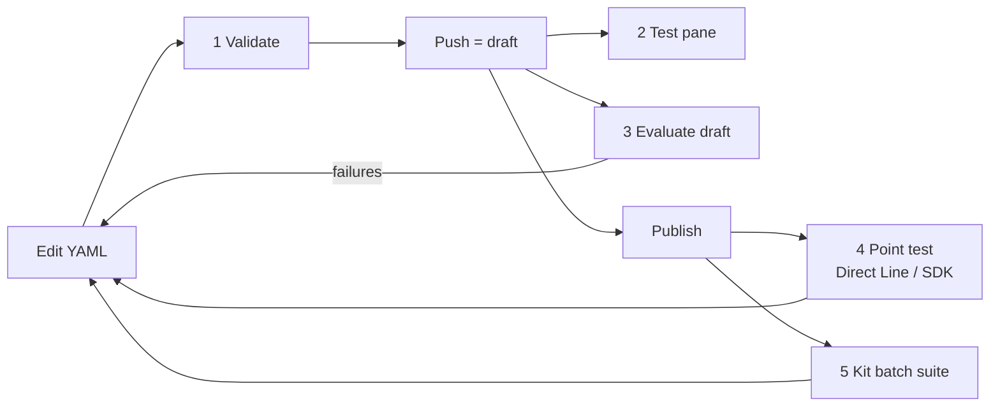

# 12 — Evaluations & testing

How to check that an agent works, from validating YAML on your machine up to automated
[evaluations](glossary.md#evaluation) (scored test runs) and batch test suites. The page also documents the YAML
test and evaluation kinds in the schema, which the source repo never authors directly.

## Testing levels at a glance

Each level catches different problems and needs a different state of the agent (local, pushed draft, or
[published](glossary.md#publish), meaning live for its users; see [02 Project layout](02-project-layout.md#lifecycle-clone--edit--validate--push--publish)).

| # | Level | Catches | Agent state needed | Tool |
|---|---|---|---|---|
| 1 | **Local validation** | Wrong `kind:`, missing required properties, [Power Fx](glossary.md#power-fx) (formula) errors, broken cross-file references | Local files | `schema-lookup validate`, `manage-agent validate`, [VS Code extension](glossary.md#vs-code-extension) ([02](02-project-layout.md#validation)) |
| 2 | **[Test pane](glossary.md#test-pane)** | Does the [topic](glossary.md#topic) (scripted flow) work at all? | Pushed draft | Copilot Studio web UI, *Test* pane |
| 3 | **In-product evaluation** | Answer quality across many questions, expected [tool](glossary.md#tool)/topic use | Pushed draft (or published) | Copilot Studio *Evaluate* tab, or the Evaluation API (`run-eval`) |
| 4 | **Point test** | What a real [channel](glossary.md#channel) client receives (text, cards, suggested actions) | **Published** | [Direct Line](glossary.md#direct-line) or Copilot Studio SDK (`chat-directline`, `chat-sdk`) |
| 5 | **Batch suite** | Regression across a stored test set, with latencies | **Published** | [Copilot Studio Kit](glossary.md#copilot-studio-kit) (`run-tests-kit`) |



The skills repo's test agent recommends a fast **edit → push → evaluate → fix** loop on the draft (level 3), with no
publishing between iterations. Point tests and Kit suites need a publish each time.

## Level 2: the Test pane

The Copilot Studio web UI has a built-in *Test* pane that chats with the **draft** right after a push. Two
things to know:

- `System.Conversation.InTestMode` is `true` there. The vendor `OnError` template uses it to show full error details
  only to makers (example below).
- It is **not a real channel**. `System.Activity.ChannelId` has its own value, so channel-specific behaviour
  ([13 Patterns](13-patterns.md#channel-aware-behavior)) must be checked in the real target channel.

```yaml
- kind: ConditionGroup
  id: conditionGroup_t3stM0
  conditions:
    - id: conditionItem_t3stM1
      condition: =System.Conversation.InTestMode = true
      actions:
        - kind: SendActivity
          id: sendMessage_t3stM2
          activity: "Error: {System.Error.Message} ({System.Error.Code})"
```

## Level 4: point-testing a published agent

The skills repo sends single utterances to a **published** agent and returns the raw response activities as JSON.
Which API it uses depends on the agent's [authentication mode](glossary.md#authentication-mode) (how the agent
identifies its users).

### Detecting the mode

`detect-mode` reads the agent's row in [Dataverse](glossary.md#dataverse) (the [Power Platform](glossary.md#power-platform) database), using the
connection details in `.mcs/conn.json`:

| `authenticationmode` | Meaning | Test route |
|---|---|---|
| 1 | No authentication | Direct Line, using the agent's token endpoint |
| 3 | Manual authentication (you configured an identity provider) | Direct Line; may return `signin_required` |
| 2 | Integrated ([Entra ID](glossary.md#entra-id) single sign-on, as in [Teams](glossary.md#teams)) | Copilot Studio SDK, which needs an [app registration](glossary.md#app-registration) |

```bash
node scripts/chat-with-agent.bundle.js --detect-only [--agent-dir <path>]
# → { "status": "ok", "mode": "directline", "authenticationmode": 1, "tokenEndpoint": "https://...", ... }
```

If detection fails with "Could not detect authentication mode", no Dataverse token is cached yet: run a push or
pull first.

### Direct Line (no auth / manual auth)

[Direct Line](glossary.md#direct-line) is the REST API for talking to a published agent from code:

```bash
node scripts/chat-with-agent.bundle.js --token-endpoint "<tokenEndpoint>" "How do I request a laptop?"
# multi-turn: pass back all three values from the previous response
node scripts/chat-with-agent.bundle.js --token-endpoint "<tokenEndpoint>" "And for contractors?" \
  --conversation-id "<id>" --directline-token "<token>" --watermark "<watermark>"
```

- The response's `activities` contain the agent's messages (`type: "message"`, `text`), suggested actions
  (`suggestedActions.actions`, which is how [quick replies](glossary.md#quick-reply) arrive), and [Adaptive Cards](glossary.md#adaptive-card)
  (`attachments` with `contentType: application/vnd.microsoft.card.adaptive`).
- The `directline_token` is bound to the conversation. Reuse it, don't fetch a new one. Tokens expire after about
  30 minutes; after that, start a new conversation.
- `watermark` marks which activities you have already seen.
- Manual-auth agents return `status: "signin_required"` with a sign-in URL. The user signs in and gets a validation
  code, which is sent with the returned `resume_command`.
- A "Token endpoint rejected" error usually means the agent isn't published.

### Copilot Studio SDK (integrated auth)

For integrated-auth agents, `chat-sdk` uses the Copilot Studio client SDK with a cached user token:

```bash
node scripts/chat-with-agent.bundle.js --client-id "<appClientId>" "hello" [--conversation-id "<id>"]
```

It needs `test-auth` to have run first (below). SDK sessions last longer than Direct Line tokens.

`chat-with-agent` and `directline-chat` are **deprecated** wrappers around the same scripts. Use `detect-mode`
followed by `chat-directline` or `chat-sdk`.

### test-auth: the app registration

The Evaluation API and SDK chat both need an **app registration** in the agent's [tenant](glossary.md#tenant) (the
organisation's Microsoft cloud directory). The token is cached and shared by `run-eval` and `chat-sdk`. The app
registration must have **all** of:

1. Redirect URI `http://localhost` under *Mobile and desktop applications*.
2. *Allow public client flows* = **Yes**. Without it, sign-in fails with `AADSTS7000218`.
3. Delegated **Power Platform API** permissions: `CopilotStudio.MakerOperations.Read` (list test sets and
   results), `CopilotStudio.MakerOperations.ReadWrite` (start runs), `CopilotStudio.Copilots.Invoke` (SDK chat).
4. Admin consent granted.

```bash
node scripts/eval-api.bundle.js auth --workspace <agent-dir> --client-id <appClientId>
```

| Error | Cause |
|---|---|
| HTTP 403 / `InsufficientDelegatedPermissions` | Missing API permission |
| `AADSTS700016` | App isn't registered in the agent's tenant (check `conn.json` → `AccountInfo.TenantId`) |
| `AADSTS7000218` | Public client flows not enabled |
| SDK chat hangs after auth | Stale cached token: delete `~/.copilot-studio-cli/test-agent.cache.json` and re-authenticate |

## Level 3: in-product evaluations

Copilot Studio's **Evaluate** tab runs a **test set** (up to 100 questions, each with an optional expected
response) against the agent and grades every answer with one or more **test methods**.

### Test sets: the CSV import format

The `create-eval-set` skill reads the agent's YAML (instructions, topics, knowledge, tools) and writes a CSV to
import with *Evaluate → New evaluation → Single response*.

```csv
"question","expectedResponse"
"Find me a hotel in Paris","The response should include hotel recommendations in Paris with relevant details like names, locations, or prices."
"Hi there","Hello! How can I help you today?"
"What is 2+2?","4"
"I want to speak to a person",
```

| Column | Required | Notes |
|---|---|---|
| `question` | Yes | The user message, max 1,000 characters |
| `expectedResponse` | No | A behavioural rubric (for General quality) or a realistic reply (for Compare meaning / Exact match) |

Rules: `.csv` file, every value double-quoted, at most 100 questions. Only these two columns are imported. A
`Testing method` column is **ignored**: every imported case gets *General quality*, and you change methods in the
UI afterwards. Aim for 10–25 cases covering core topics, knowledge answers, [system topics](glossary.md#system-topic) (greeting, escalation,
goodbye), out-of-scope requests, and things the agent must not do.

### Test methods

| Test method (UI) | Measures | Needs expected response? |
|---|---|---|
| **General quality** (default) | AI-graded relevance, completeness, groundedness, abstention | No (a rubric helps) |
| **Compare meaning** | Semantic similarity to the expected response | Yes; pass threshold set in the UI |
| **Text similarity** | Cosine similarity of the text | Yes; pass threshold set in the UI |
| **Exact match** | Character-for-character equality | Yes |
| **Keyword match** | Response contains expected keywords/phrases | Keywords added in the UI |
| **Capability use** | The agent called the expected tools / topics | Configured in the UI |
| **Custom** | Your own grader instructions and labels | Configured in the UI |

### Running an evaluation

Either press **Evaluate** in the UI, or use the skills repo's `run-eval` skill, which drives the Power Platform
**Evaluation API** and works on the **draft**, with no publish needed.

```bash
node scripts/eval-api.bundle.js list-testsets --workspace <dir> --client-id <id>
node scripts/eval-api.bundle.js start-run     --workspace <dir> --client-id <id> --testset-id <id> \
     --run-name "Draft eval 2026-11-05" [--connection-id <id>] [--published]
node scripts/eval-api.bundle.js get-run       --workspace <dir> --client-id <id> --run-id <id>   # poll every 15–30 s
node scripts/eval-api.bundle.js get-results   --workspace <dir> --client-id <id> --run-id <id>
```

Under the hood these call
`https://api.powerplatform.com/copilotstudio/environments/<envId>/bots/<agentId>/api/makerevaluation/…`
(`testsets`, `testsets/<id>/run`, `testruns/<id>`). Things to know:

- Test sets are **created in the UI**. The API lists and runs them; it doesn't create them.
- **Authenticated tools and knowledge.** Without `--connection-id`, the run is anonymous, and tools and
  [knowledge sources](glossary.md#knowledge-source) that need the user's identity **won't be used**. The ID is that
  of a *Microsoft Copilot Studio* [connection](glossary.md#connection), copied from the URL of the connection's page
  in the [Power Automate](glossary.md#power-automate) portal (make.powerautomate.com → Connections).
- Only one run at a time per agent (HTTP 409), and at most **20 runs per agent per 24 hours** (HTTP 429).
- A run ends in state `Completed`, `Failed`, `Abandoned` or `Cancelled`.

| Failed metric | Look at |
|---|---|
| `GeneralQuality` | Which of relevance / completeness / groundedness / abstention failed |
| `ExactMatch` | The 0.0–1.0 score |
| `CapabilityUse` | `missingInvocationSteps` (tools/topics that should have run) |
| status `Error` | `errorReason`, often a test-set configuration problem rather than a YAML one |

### Analysing exported results

The `analyze-evals` skill reads the CSV you can export from the Evaluate tab (`Evaluate <agent> <date>.csv`):

| Column | Meaning |
|---|---|
| `question`, `expectedResponse` | From the test set |
| `actualResponse` | What the agent said |
| `testMethodType_N` | Test method N (e.g. `GeneralQuality`) |
| `result_N` | `Pass` / `Fail` |
| `passingScore_N` | Threshold, if any |
| `explanation_N` | Why, e.g. "Seems relevant; Seems incomplete; Knowledge sources not cited" |

How to read the explanations:

| Explanation | Usual fix |
|---|---|
| "Question not answered" | Missing topic or knowledge source; check `modelDescription` and [trigger phrases](glossary.md#trigger-phrases) |
| "Knowledge sources not cited" | Knowledge configuration, or how `SearchAndSummarizeContent` is used ([07 Knowledge](07-knowledge.md)) |
| "Seems incomplete" | Early exits or missing branches in the topic flow |
| `GenAIToolPlannerRateLimitReached` in `actualResponse` | A transient runtime error, not an authoring problem: retry |

## Level 5: Copilot Studio Kit batch tests

The [Copilot Studio Kit](glossary.md#copilot-studio-kit) (a Microsoft add-on installed into an
[environment](glossary.md#environment)) stores test sets in Dataverse and runs them against a **published** agent.
The `run-tests-kit` skill needs a `tests/settings.json`:

```json
{
  "dataverse": {
    "environmentUrl": "https://orgXXXXXX.crm.dynamics.com",
    "tenantId": "<tenant GUID>",
    "clientId": "<app registration GUID>"
  },
  "testRun": {
    "agentConfigurationId": "<Kit agent configuration GUID>",
    "agentTestSetId": "<Kit test set GUID>"
  }
}
```

It then runs `node tests/run-tests.js --config-dir ./tests` (device-code sign-in on first use). The script polls
every 20 seconds and writes `tests/test-results-*.csv` with *Test Utterance, Expected Response, Response,
Latency (ms), Result, Test Type, Result Reason*.

| Test type | Failure usually means |
|---|---|
| Response Match | Wrong `SendActivity` text, instructions or generative-answer configuration |
| Topic Match | Wrong or no topic triggered: check trigger phrases and `modelDescription` |
| Generative Answers | Knowledge sources, `SearchAndSummarizeContent`, instructions |
| Multi-turn | Topic flow, variables, conditions |
| Plan Validation | The [orchestrator](glossary.md#orchestrator)'s plan was wrong: topic descriptions, instructions |
| Attachments | Cards/files not as expected |

Result codes: 1 Success, 2 Failed, 3 Unknown, 4 Error, 5 Pending.

## Evaluation and test definitions in YAML

The schema defines a family of test and evaluation kinds, but **nothing in the source repo authors or reads them**:
its skills drive evaluations through CSV import and the Evaluation API only. No template, pattern or skill shows
these kinds, and their schema descriptions are placeholder tokens. Everything in this section therefore comes from
the **structure** of the schema alone. The mapping to UI concepts is inferred from names. Treat these kinds as a
reference for reading what you might find in a cloned solution, not as a documented authoring route.

### The container: TestCaseComponent

A [TestCaseComponent](reference/schema/components.md#testcasecomponent) (a component type, like a topic) has a
required `schemaName` and a required `definition` of type
[TestDefinitionBase](reference/schema/evaluation.md#testdefinitionbase), which is one of:

| Kind | Properties | Apparent purpose |
|---|---|---|
| [TestSetDefinition](reference/schema/evaluation.md#testsetdefinition) | *(none)* | Marks the component as a test set |
| [TestCaseDefinition](reference/schema/evaluation.md#testcasedefinition) | `transcriptDefinition.testActivities`, `index` | A scripted test: user activities, each with assertions on the reply |
| [EvaluationSet](reference/schema/evaluation.md#evaluationset) | `graders`, `inputType` | An evaluation set: which graders score each case |
| [EvaluationData](reference/schema/evaluation.md#evaluationdata) | `rows` (single-turn cases) | The rows (questions) of an evaluation set |
| [MultiTurnEvaluationCase](reference/schema/evaluation.md#multiturnevaluationcase) | `activities`, `expectedOutput`, `expectedKeywords`, `expectedExecutionSteps`, `source` | One multi-turn conversation case |
| [EvaluationRunDefinition](reference/schema/evaluation.md#evaluationrundefinition) | `target` ✓, `evaluationSetSchemaName` ✓ | A run of an evaluation set against a target |

`source` on cases ([TestActivitySourceType](reference/schema/evaluation.md#testactivitysourcetype)) is one of
`Manual` (default), `Generated`, `Edited`, `Imported` or `AnalyticsTheme`, presumably how the case was created.

### Graders (GraderBase)

Graders score evaluation cases. Ten kinds ([GraderBase](reference/schema/evaluation.md#graderbase)); the "UI test
method" column is matched by name only:

| Kind | Properties | Likely UI test method |
|---|---|---|
| [GeneralQualityGrader](reference/schema/evaluation.md#generalqualitygrader) | — | General quality |
| [CompareMeaningGrader](reference/schema/evaluation.md#comparemeaninggrader) | `threshold` (default 0.6) | Compare meaning |
| [TextSimilarityGrader](reference/schema/evaluation.md#textsimilaritygrader) | `threshold` (default 0.7) | Text similarity |
| [ExactMatchGrader](reference/schema/evaluation.md#exactmatchgrader) | — | Exact match |
| [ContainsAllGrader](reference/schema/evaluation.md#containsallgrader) | — | Keyword match (all keywords) |
| [ContainsAnyGrader](reference/schema/evaluation.md#containsanygrader) | — | Keyword match (any keyword) |
| [ToolCallGrader](reference/schema/evaluation.md#toolcallgrader) | `name` ✓ | Capability use |
| [PromptGrader](reference/schema/evaluation.md#promptgrader) | `name` ✓, `instructions` ✓, `model`, `labels` (each `name`, `description`, `outcome: Pass\|Fail`) | Custom (LLM grader with your instructions and labels) |
| [TaskSuccessGrader](reference/schema/evaluation.md#tasksuccessgrader) | — | No UI equivalent in the sources |
| [CodeGrader](reference/schema/evaluation.md#codegrader) | `name` ✓, `code` ✓, `threshold` (default 0.5) | No UI equivalent in the sources |

### Assertions (TestAssertionBase)

Assertions are checks attached to one user turn of a scripted test case (`SendUserActivity.activityAssertions`).
There are nine kinds ([TestAssertionBase](reference/schema/evaluation.md#testassertionbase)). The first four match
the four sub-checks of *General quality*:

| Kind | Properties | Checks (inferred from the name) |
|---|---|---|
| [RelevanceAssertion](reference/schema/evaluation.md#relevanceassertion) | — | The reply is relevant |
| [CompletenessAssertion](reference/schema/evaluation.md#completenessassertion) | — | The reply is complete |
| [GroundednessAssertion](reference/schema/evaluation.md#groundednessassertion) | — | The reply is grounded in sources |
| [AbstentionAssertion](reference/schema/evaluation.md#abstentionassertion) | — | The agent abstains when it should |
| [ExactMatchAssertion](reference/schema/evaluation.md#exactmatchassertion) | `expectedResponse` | Exact text |
| [IntentMatchAssertion](reference/schema/evaluation.md#intentmatchassertion) | `expectedResponse`, `scoreThreshold` (default 60) | Same intent/meaning |
| [CosineEmbeddingSimilarityAssertion](reference/schema/evaluation.md#cosineembeddingsimilarityassertion) | `expectedResponse`, `scoreThreshold` (default 0.7) | Embedding similarity |
| [ContainsAllAssertion](reference/schema/evaluation.md#containsallassertion) | `expectedResponses` (list) | Contains every string |
| [ContainsAnyAssertion](reference/schema/evaluation.md#containsanyassertion) | `expectedResponses` (list) | Contains at least one string |

### Targets and expected steps

| Kind | Properties | Purpose |
|---|---|---|
| [AgentEvaluationTarget](reference/schema/evaluation.md#agentevaluationtarget) | `agentSchemaName` ✓ | Evaluate an agent |
| [PromptEvaluationTarget](reference/schema/evaluation.md#promptevaluationtarget) | `aIModelId` ✓ | Evaluate an [AI Builder](glossary.md#ai-builder) prompt |
| [FlowEvaluationTarget](reference/schema/evaluation.md#flowevaluationtarget) | `flowId` ✓ | Evaluate a [flow](glossary.md#cloud-flow) |
| [ExpectedTopicTriggeredStep](reference/schema/evaluation.md#expectedtopictriggeredstep) | `schemaName` ✓ | This topic should run (cf. *Capability use*) |
| [ExpectedToolCallStep](reference/schema/evaluation.md#expectedtoolcallstep) | `schemaName` ✓ | This tool should be called |

### Schema-valid examples

These validate against the schema. Nothing in the sources confirms that Copilot Studio accepts them in a pushed
agent folder, and the skills repo's folder layout has no place for test components.

An evaluation set with three graders:

```yaml
kind: TestCaseComponent
schemaName: cr26e_myAgent.testcase.HoursEvalSet
displayName: Opening hours evaluation set
definition:
  kind: EvaluationSet
  graders:
    - kind: GeneralQualityGrader
    - kind: CompareMeaningGrader
      threshold: 0.7
    - kind: PromptGrader
      name: Politeness
      instructions: Label the response Polite if it is courteous and professional, otherwise Rude.
      labels:
        - name: Polite
          outcome: Pass
        - name: Rude
          outcome: Fail
```

Its rows, one with an expected topic:

```yaml
kind: EvaluationData
rows:
  - input: When are you open on Saturdays?
    expectedOutput: We're open 9am to 1pm on Saturdays.
    expectedKeywords:
      - Saturday
      - 9am
    expectedExecutionSteps:
      - kind: ExpectedTopicTriggeredStep
        schemaName: cr26e_myAgent.topic.OpeningHours
  - input: Can you book me a flight?
    expectedOutput: The agent politely explains it only answers questions about store opening hours.
```

A multi-turn case:

```yaml
kind: MultiTurnEvaluationCase
source: Manual
activities:
  - activity: I need to send a complaint
  - activity: The delivery was three days late
    expectedOutput: The agent confirms the complaint text and offers to send it.
expectedExecutionSteps:
  - kind: ExpectedToolCallStep
    schemaName: <tool schema name>
```

A run of the set against the agent:

```yaml
kind: EvaluationRunDefinition
evaluationSetSchemaName: cr26e_myAgent.testcase.HoursEvalSet
target:
  kind: AgentEvaluationTarget
  agentSchemaName: cr26e_myAgent
```

A scripted test case with per-turn assertions:

```yaml
kind: TestCaseComponent
schemaName: cr26e_myAgent.testcase.GreetingTest
definition:
  kind: TestCaseDefinition
  transcriptDefinition:
    testActivities:
      - kind: SendUserActivity
        activity: Hello
        activityAssertions:
          - kind: ContainsAnyAssertion
            expectedResponses:
              - Hello
              - Hi
          - kind: RelevanceAssertion
```

(The `.testcase.` part of these schema names is illustrative. The sources don't document a naming pattern for test
components.)

## Not to be confused with: the plugin's own eval harness

The vendored repo also has a top-level `evals/` folder (`evaluate.py`, `run.js`, `scenarios/*.json`,
`fixtures/`) and a `create-eval` skill. These **test the skills plugin itself**, not your agent. Each scenario
runs a natural-language prompt through Claude Code against a fixture agent folder, then checks deterministic
expectations: which sub-agent and skill were invoked, which files were created, whether the YAML validates, and
that no `_REPLACE` placeholders remain. For example, `evals/scenarios/eval-test-set.json` checks that asking to
"prepare an evaluation test set" routes to the Test agent, invokes `create-eval-set`, and writes a `*.csv`. Use
`create-eval-set` / `run-eval` for Copilot Studio agent evaluations; use `create-eval` only if you are developing the
skills themselves.

## Sources

- `vendor/skills-for-copilot-studio/agents/copilot-studio-test.md`: testing workflows, draft vs published
- `vendor/skills-for-copilot-studio/skills/detect-mode/SKILL.md`, `skills/chat-directline/SKILL.md`, `skills/chat-sdk/SKILL.md`, `skills/chat-with-agent/SKILL.md`, `skills/directline-chat/SKILL.md`: point testing
- `vendor/skills-for-copilot-studio/skills/test-auth/SKILL.md`: app registration requirements and errors
- `vendor/skills-for-copilot-studio/skills/create-eval-set/SKILL.md`: CSV format, test methods
- `vendor/skills-for-copilot-studio/skills/run-eval/SKILL.md`, `scripts/src/eval-api.js`: Evaluation API, limits, connection ID
- `vendor/skills-for-copilot-studio/skills/analyze-evals/SKILL.md`: exported results CSV
- `vendor/skills-for-copilot-studio/skills/run-tests-kit/SKILL.md`: Copilot Studio Kit batch tests
- `vendor/skills-for-copilot-studio/skills/create-eval/SKILL.md`, `evals/evaluate.py`, `evals/scenarios/eval-test-set.json`: the plugin's own eval harness
- `vendor/skills-for-copilot-studio/templates/topics/error-handler.topic.mcs.yml`, `skills/int-reference/SKILL.md`: `System.Conversation.InTestMode`
- `vendor/skills-for-copilot-studio/patterns/channel-aware-behavior.md`: Test pane is not a real channel
- `vendor/skills-for-copilot-studio/SETUP_GUIDE.md`: testing options
- `vendor/skills-for-copilot-studio/reference/bot.schema.yaml-authoring.json`: test/evaluation kinds (via [evaluation](reference/schema/evaluation.md))
